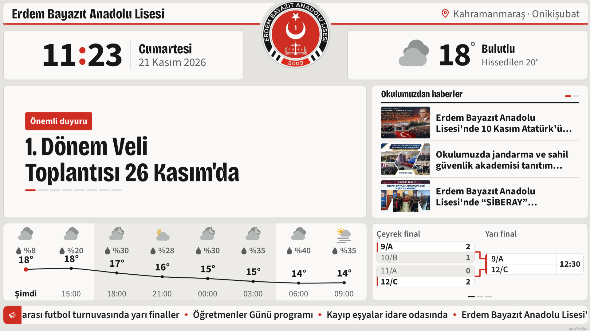
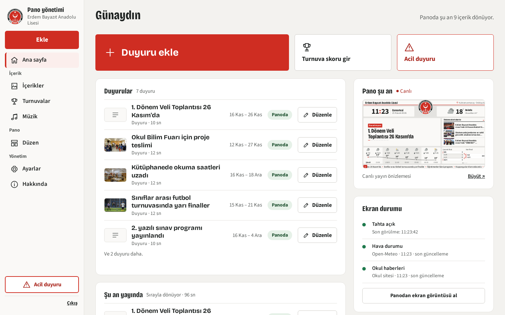
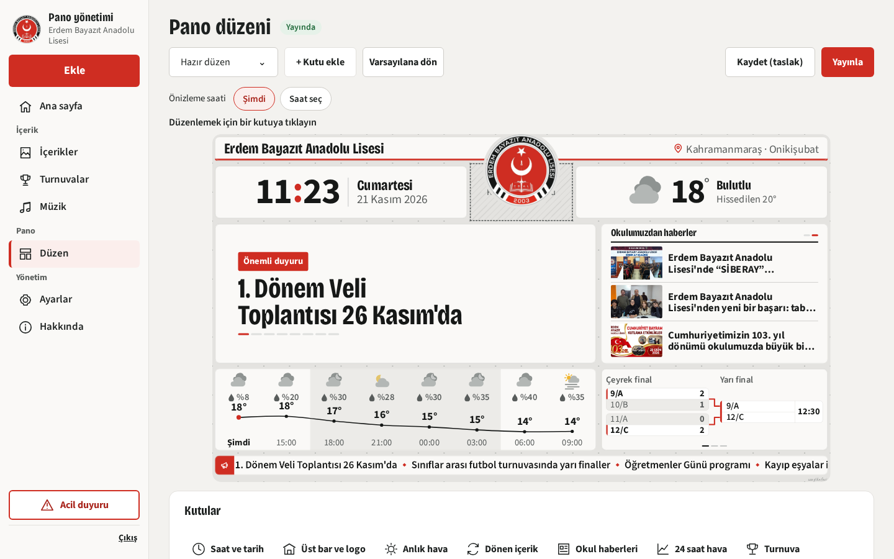
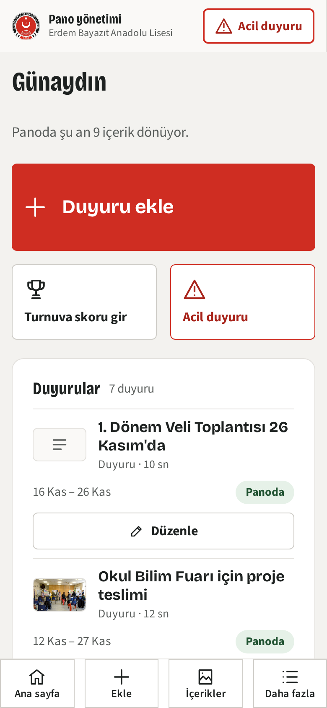
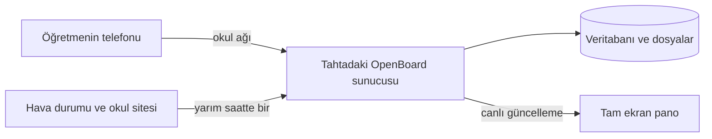

  

<h1 align="center">OpenBoard</h1>

  Okul koridorundaki ekran ve akıllı tahta için duyuru panosu. 
  Duyuruyu telefondan ekle, pano kendini güncellesin; internet kesilse de çalışmaya devam eder.

  

  
  
  

  

<table>
  <tr>
    <td align="center"></td>
    <td align="center"></td>
    <td align="center"></td>
  </tr>
  <tr>
    <td align="center">Yönetim</td>
    <td align="center">Düzen</td>
    <td align="center">Telefonda</td>
  </tr>
</table>

## İçindekiler

- [Neden yaptım?](#neden-yaptım)
- [Neler yapabilirsin?](#neler-yapabilirsin)
- [Kurulum](#kurulum)
- [Nasıl kullanılır?](#nasıl-kullanılır)
- [Nasıl çalışır?](#nasıl-çalışır)
- [Kullanılan teknolojiler](#kullanılan-teknolojiler)
- [Sık sorulanlar](#sık-sorulanlar)
- [Katkı ve geri bildirim](#katkı-ve-geri-bildirim)
- [Lisans](#lisans)

## Neden yaptım?

Okulumuzun kantinindeki akıllı tahta bütün gün açık duruyordu ama ya boştu ya da günlerce aynı şeyi gösteriyordu. Elimizdeki eski pano programı yalnız tahtadaki bilgisayardan yönetiliyordu; duyuru eklemek için birinin tahtanın başına gitmesi gerekiyordu. OpenBoard'u bu yüzden sıfırdan, öğretmenin telefondan 30 saniyede duyuru ekleyebileceği biçimde yaptım. İlk olarak Erdem Bayazıt Anadolu Lisesi'nde kullanılıyor; görüntülerdeki okul odur. Kurulumda kendi okulunun adını, yerini ve logosunu girersin.

## Neler yapabilirsin?

- Duyuru, fotoğraf, video, YouTube videosu, PDF ve sunuyu sırayla döndür; her birine tarih, gün ve saat aralığı ver.
- Panoyu kutularla düzenle: sürükle, boyutlandır, yayınla. Bir kutu yalnız teneffüste ya da belirli saatlerde görünebilir.
- Ders zili sayacı, saat, hava durumu ve okul sitesinden haberler kendiliğinden güncellenir.
- Turnuva tablosu kur: kura, skor, yaklaşan maçlar ve son sonuçlar panoda.
- Teneffüste müzik çal; ders başlayınca ya da sesli video çıkınca kendiliğinden susar.
- Acil bir durumda tek düğmeyle bütün ekranı kapla.
- Yönetime tek şifreyle gir; yaptığını geri al, bütün kurulumu tek dosyayla yedekle.

Tüm özellikler

**Panoda**
- Saat, tarih, anlık ve saatlik hava durumu
- Ders zili sayacı: hangi derste olunduğu, sonraki zile kalan süre
- Dönen içerik: duyuru, fotoğraf, video, YouTube, PDF, sunu; fotoğrafta kadraj, videoda başlangıç ve bitiş kırpma
- Duyuruda görselin yeri (üst, alt, sol, sağ, arka plan) ve renk seçimi
- Kayan yazı ve acil duyuru
- Turnuva: tek eleme, çift eleme, lig, grup + eleme; ağaç, turlara göre liste, yaklaşan maçlar, son sonuçlar
- Nöbetçi öğretmen, sınav takvimi, geri sayım, günün sözü, etkinlik, başarılar, doğum günleri, galeri, karekod
- Her kutu boyutuna göre ayrı tasarlanmış görünüm; uzun yazı kesilmeden sığar
- Ekrana dokunmak hiçbir şeyi değiştirmez

**Yönetimde**
- Ana sayfada duyuru ekleme, panonun canlı önizlemesi ve ekran durumu
- Düzen: kutuları taşı, boyutlandır, içeriğini ve görüneceği zamanı seç, taslak kaydet, yayınla
- Takvim: hangi kutuda ne zaman ne döneceği
- Teneffüs müziği ve ayrı fon müziği listesi, ses düzeyi, saat aralığı
- Okul adı, logo, konum, zil ve tahta saatleri
- Geçmiş ve geri alma, tek dosyalık yedek ve geri yükleme
- Telefon ve tablette rahat kullanılır

**Tahta bilgisayarında**
- İlk açılışta tek pencerede kurulum
- Bilgisayar açılınca panoyu başlatır (60 saniye içinde vazgeçilebilir), son dersten sonra bilgisayarı kapatır (iptal edilebilir uyarıyla)
- Öğretmenler için okul ağı adresi ve karekod
- Şifre unutulursa **Şifreyi sıfırla**
- Yeni sürümleri ders dışında kurar; duyurular, düzen ve ayarlar korunur, öncesinde yedek alınır

## Kurulum

1. [Son sürüm](https://github.com/uzaylikafasi/openboard-surumler/releases/latest) sayfasından `OpenBoard-Kurulum-<sürüm>.exe` dosyasını indirip tahta bilgisayarında çalıştır. Kurulum tek pencerede biter, masaüstüne kısayol eklenir.
2. Açılan pencerede okulunun adını, il ve ilçeyi, logoyu ve yönetim şifresini gir. Başka bir bilgisayardan geçiyorsan **Başka cihazdan aktar** ile yedek dosyanı seç.
3. **Panoyu başlat** de. Yönetim için pencerede yazan adresi telefonundan aç ya da karekodu okut.

> [!NOTE]
> Windows "bilinmeyen yayıncı" uyarısı verirse **Ek bilgi → Yine de çalıştır** seç.

Sistem gereksinimleri

- Windows 10 veya 11, 64 bit
- Öğretmenlerin telefonu ya da bilgisayarı tahtayla aynı okul ağında olmalı
- İnternet yalnız hava durumu, haberler, YouTube ve güncellemeler için gerekir
- İsteğe bağlı: sunu dönüştürmek için LibreOffice, PDF için Poppler, video dönüştürmek için ffmpeg (aşağıda)

Ek araçlar: sunu, PDF ve video için

OpenBoard fotoğrafı ve duyuruyu tek başına gösterir. PowerPoint sunusu, PDF ve farklı biçimdeki videolar için tahta bilgisayarına şu ücretsiz araçlardan gerekenleri kur:

| Ne için | Araç | Kurulum |
|---|---|---|
| PowerPoint (`.pptx`, `.ppt`) ve `.odp` sunu | LibreOffice | Komut İstemi'nde `winget install --id TheDocumentFoundation.LibreOffice -e` ya da [libreoffice.org](https://www.libreoffice.org/download/download/) |
| PDF | Poppler | [Poppler Windows paketini](https://github.com/oschwartz10612/poppler-windows/releases) indir, bir klasöre çıkar (ör. `C:\poppler`) |
| Video dönüştürme | ffmpeg | Komut İstemi'nde `winget install --id Gyan.FFmpeg -e` |

Sonra OpenBoard'a nerede olduklarını göster:

1. LibreOffice varsayılan yere (`C:\Program Files\LibreOffice`) kurulduysa bir şey yapma, kendiliğinden bulunur.
2. Yönetimde **Ayarlar → Tahta saatleri** sekmesini aç. Altta **LibreOffice yolu**, **Poppler pdftoppm yolu**, **Poppler pdfinfo yolu** ve **Video dönüştürücü yolu** alanları var.
3. Poppler için `pdftoppm.exe` ve `pdfinfo.exe` dosyalarının tam yolunu yaz (ör. `C:\poppler\Library\bin\pdftoppm.exe`). Aynı klasördeki diğer dosyaları silme.
4. ffmpeg'i winget ile kurduysan alanda `ffmpeg` yazılı kalabilir; başka yere çıkardıysan `ffmpeg.exe` dosyasının tam yolunu yaz.
5. Kaydet. Önceden dönüştürülemeyen bir dosya varsa **İçerikler**de o dosyanın **Yeniden dene** düğmesine bas.

Araç kurulu değilse o sunu ya da PDF panoda atlanır, pano çalışmaya devam eder. ffmpeg yoksa video dönüştürülmeden, olduğu gibi oynatılır.

## Nasıl kullanılır?

Örnek: Pazartesi veli toplantısı var, cumaya kadar panoda dursun, kantin ekranında da görünsün.

1. Telefonundan tahtanın pencerede yazan adresini aç (ya da karekodu okut) ve şifreyle gir.
2. Ana sayfada **Duyuru ekle**ye bas. Başlığa "Veli toplantısı pazartesi 15.00", metne ayrıntıyı yaz; istersen bir fotoğraf ekle ve yerini (üst, sol, arka plan) seç.
3. Başlangıç ve bitiş tarihini seç, önemliyse **Önemli** işaretini aç. Sağdaki önizlemede panoda nasıl duracağını gör.
4. **Yayınla**ya bas. Duyuru birkaç saniye içinde panodaki dönen içeriğe girer; cuma günü süresi dolunca kendiliğinden kalkar.
5. Ana sayfadaki **Pano şu an** önizlemesinden duyurunun ekrana geldiğini kontrol et.

Aynı yerden **Turnuva skoru gir** ile maç sonucunu yazarsın, tablo kendiliğinden ilerler. Acil bir durumda **Acil duyuru** yazdığın metni bütün ekranda gösterir. Panonun düzenini değiştirmek için **Düzen** sayfasında kutuları sürükleyip **Yayınla** dersin.

## Nasıl çalışır?

Tahta bilgisayarına kurulan uygulama iki iş yapar: okul ağında küçük bir sunucu açar ve panoyu tam ekran gösterir. Öğretmenler bu sunucunun yönetim sayfasına aynı ağdaki telefon ya da bilgisayardan girer. Bir değişiklik yayınlanınca sunucu panoya haber verir, pano yeniden çizilir. Bütün veri tahta bilgisayarındaki tek bir veritabanı dosyasında durur; bulut hesabı, üyelik ya da kiralık sunucu gerekmez. Hava durumu ve okul haberleri yarım saatte bir internetten alınır, son alınan bilgi saklanır; bağlantı kesilirse o gösterilir.

## Kullanılan teknolojiler

| Parça | Ne kullanıldı | Neden |
|---|---|---|
| Masaüstü uygulaması | Electron, electron-builder, electron-updater | Panoyu ve sunucuyu tek kurulumla tahtaya koymak, güncellemeleri ders dışında kendiliğinden kurmak için |
| Sunucu | Node.js, Fastify, TypeScript | Tahtadaki bilgisayarda az kaynakla çalışan küçük bir web sunucusu; hem panoya hem yönetim sayfasına hizmet eder |
| Veri | SQLite (Node'un yerleşik modülü) | Tek dosya, ayrı veritabanı kurulumu ve derleme gerektirmez; yedek almak dosyayı kopyalamaktır |
| Pano ve yönetim | React, Vite, düz CSS | Öğretmen ayrı uygulama kurmadan telefonun tarayıcısından yönetir; arayüz kütüphanesi olmadan okulun görünümüne göre tasarlandı |
| Canlı güncelleme | Server-Sent Events | Yayınlanan değişiklik panoya saniyeler içinde gider, bağlantı koparsa kendiliğinden yeniden bağlanır |
| Hava durumu | Open-Meteo | Anahtar ve üyelik istemez |
| Dönüştürme | LibreOffice, Poppler, ffmpeg | Sunuyu, PDF'i ve videoyu panonun oynatabileceği biçime çevirmek için; isteğe bağlı |
| Test | Vitest, Playwright | Turnuva motoru ve sunucu için birim testleri, pano ve yönetim için tarayıcıda uçtan uca testler |

Kaynak kod özel bir depoda tutulur; bu depo kurulum dosyalarını ve güncellemeleri dağıtır.

## Sık sorulanlar

Ücretli mi?

Hayır. Okullar, öğretmenler ve kâr amacı gütmeyen kurumlar ücretsiz kullanır. Satılamaz, ticari amaçla kullanılamaz.

İnternet kesilirse ne olur?

Pano çalışmaya devam eder. Duyurular, fotoğraflar ve videolar tahtadadır; hava durumu ve haberlerde son alınan bilgi gösterilir. YouTube videoları atlanır.

Başka bir bilgisayara nasıl taşırım?

Yönetimde **Ayarlar → Yedek** ile tek dosyalık yedeği indir. Yeni bilgisayarda kurulum penceresindeki **Başka cihazdan aktar** ile bu dosyayı seç.

## Katkı ve geri bildirim

Hata ya da istek için [Issues](https://github.com/uzaylikafasi/openboard-surumler/issues) sayfasına yaz. Ekran görüntüsü ve OpenBoard sürümünü eklersen daha hızlı çözülür.

## Teşekkür

Hava durumu verisi [Open-Meteo](https://open-meteo.com/) üzerinden gelir.

## Lisans

PolyForm Noncommercial 1.0.0. Ayrıntı: [LICENSE.md](LICENSE.md).

Copyright 2026 Ömer Kaan Erdemli · [uzaylikafasi](https://github.com/uzaylikafasi)
