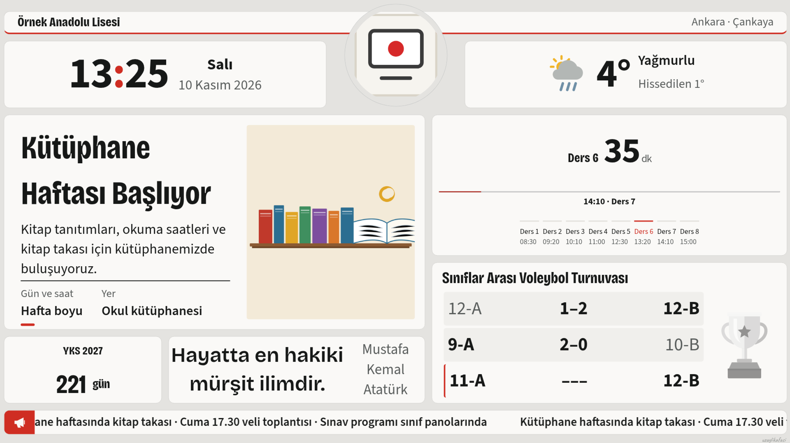
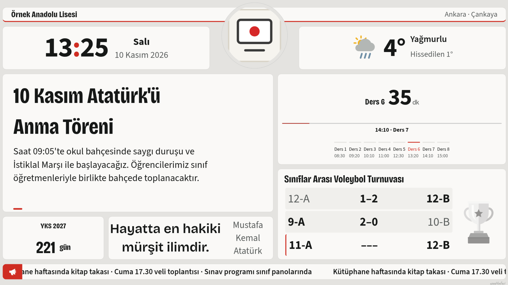
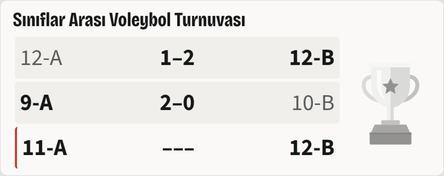
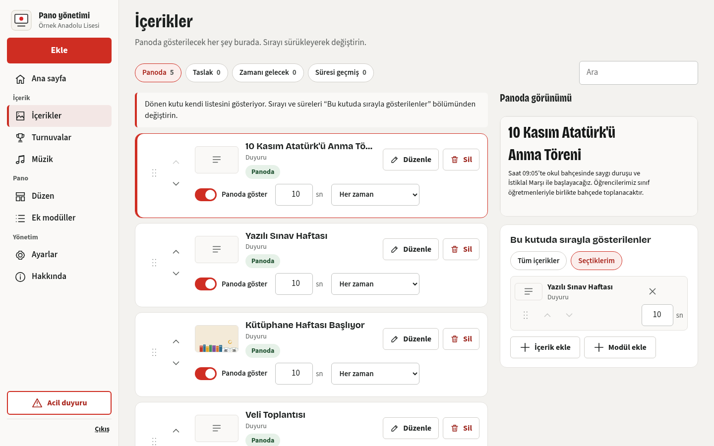
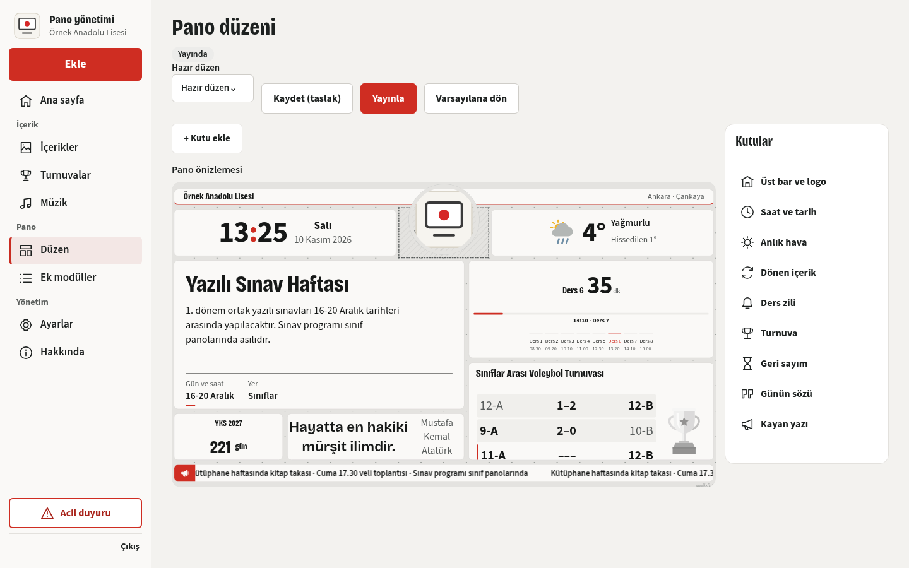
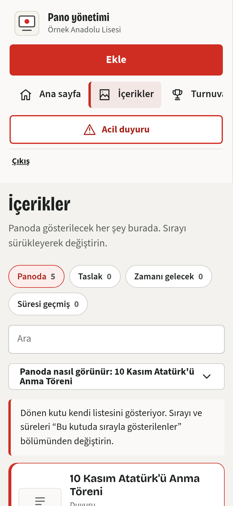
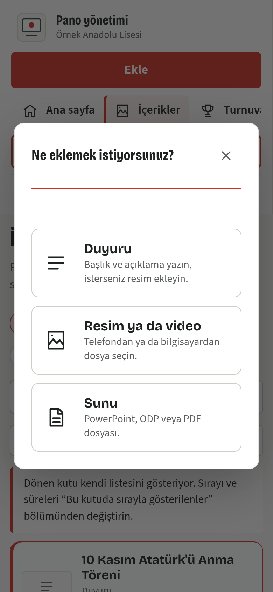
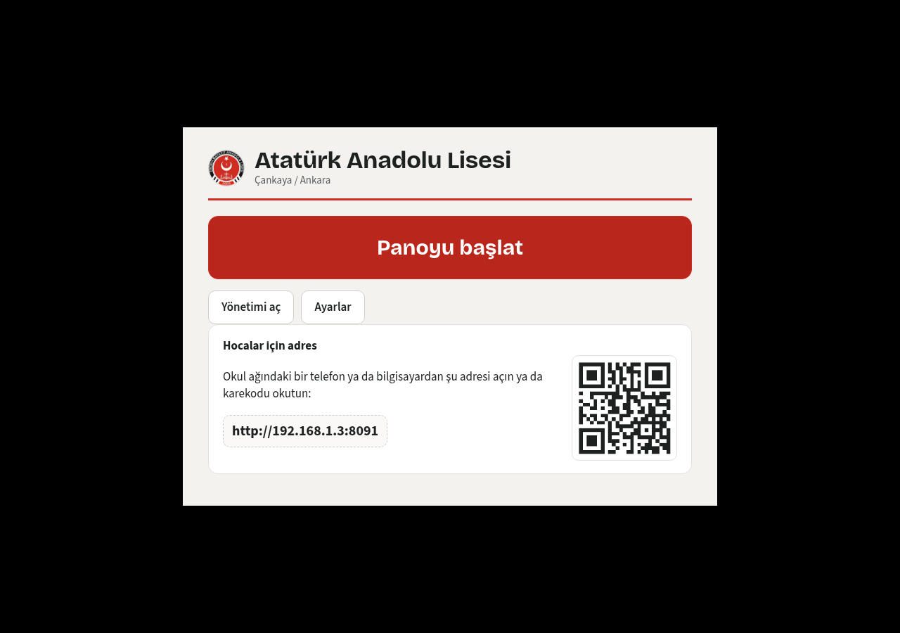

  

<h1 align="center">OpenBoard</h1>

  Okul koridorları ve akıllı tahtalar için duyuru panosu. 
  Duyurular, ders zili, hava durumu, turnuvalar ve okul haberleri tek ekranda; yönetimi telefondan bile birkaç dokunuş.

  <a href="https://github.com/uzaylikafasi/openboard-surumler/releases/latest"><b>Son sürümü indir</b></a> ·
  <a href="#kurulum">Kurulum</a> ·
  <a href="#ozellikler">Özellikler</a> ·
  <a href="#lisans">Lisans</a>

---

## Neden OpenBoard?

Okullardaki ekranlar çoğu zaman ya boş durur ya da aylarca aynı slaytı gösterir. OpenBoard'da öğretmenler duyuruyu telefonlarından ekler, pano kendini günceller. İnternet kesilse bile çalışmaya devam eder; öğrenci ekrana dokunsa da bir şey bozulmaz.

## Özellikler

**Panoda**
- Saat, tarih ve hava durumu (saatlik tahminle)
- Ders zili sayacı: hangi derste olunduğu, bir sonraki zile kaç dakika kaldığı
- Sırayla dönen içerik kutusu: duyuru, resim, video, PDF, sunu ve modüller
- Kayan yazı, acil duyuru (tek dokunuşla tüm ekranı kaplar)
- Turnuva tabloları: tek eleme, çift eleme, lig, grup + eleme; kura çekimi dahil
- Ek modüller: sınav geri sayımı, günün sözü, nöbetçi öğretmen, etkinlikler, başarılar, doğum günleri, QR kod
- Dokunma kilidi: ekrana dokunmak hiçbir şeyi değiştirmez

**Yönetimde**
- Tek "İçerikler" sayfası: ekle, sırala, zamanla, panodan kaldır, geri al
- Sürükle-bırak düzen: kutuları taşı, boyutlandır, yayınla
- Okul adı, logo, konum, zil ve tahta saatleri
- Geçmiş ve yayın takvimi
- Yedek al / geri yükle: tüm kurulumu tek dosyayla başka bilgisayara taşı
- Telefon ve tablette rahat kullanılır

**Tahtada (Windows uygulaması)**
- İlk açılışta tek pencerede kurulum: okul bilgileri ve yönetici hesabı
- Bilgisayar açılınca panoyu kendiliğinden başlatır (60 sn içinde vazgeçilebilir)
- Son dersten sonra bilgisayarı kapatır (iptal edilebilir uyarıyla)
- Hocalar için okul ağı adresi ve karekod
- Yeni sürümleri kendiliğinden kurar; sorun olursa eski sürüme döner

## Görüntüler

| Pano | Turnuva |
|---|---|
|  |  |

| İçerikler | Düzen |
|---|---|
|  |  |

| Telefonda | Ekle | Başlatıcı |
|---|---|---|
|  |  |  |

## Kurulum

[Releases](https://github.com/uzaylikafasi/openboard-surumler/releases/latest) sayfasından paketi indirin. İnternet bağlantısı gerekmez.

### Windows uygulaması (önerilen)

1. `OpenBoard-windows-<sürüm>.zip` dosyasını sağ tıklayıp **Tümünü ayıkla** ile bir klasöre açın.
2. `OpenBoard/OpenBoard.exe` dosyasını çalıştırın. Uygulama kendini kurar ve masaüstüne kısayol ekler.
3. Açılan pencerede okul adını, il/ilçeyi ve yönetici hesabını girin. Başka bir bilgisayardan geçiyorsanız **Başka cihazdan aktar** ile yedek dosyanızı seçin.
4. **Panoyu başlat**. Yönetim için pencerede yazan adresi telefonunuzdan açın ya da karekodu okutun.

### Yalnız sunucu (Electron'suz)

`openboard-sunucu-windows-<sürüm>.zip` dosyasını açın, `KUR.cmd` dosyasına çift tıklayın. `C:\OpenBoard` içine kurulur, oturum açılınca pano tam ekran başlar.

İsteğe bağlı: sunu ve PDF dönüştürmek için LibreOffice ve Poppler, video dönüştürmek için ffmpeg.

## Güncellemeler

Windows uygulaması açılışta ve altı saatte bir bu depoyu kontrol eder. Yeni sürüm bulduğunda indirir, SHA-256 değerini doğrular ve veriye dokunmadan uygulamayı yeniler. Yeni sürüm açılmazsa eskisine döner. İsterseniz otomatik güncellemeyi başlatıcının Ayarlar bölümünden kapatabilirsiniz.

## Lisans

[PolyForm Noncommercial 1.0.0](LICENSE.md). Okullar, öğretmenler, öğrenciler ve kâr amacı gütmeyen kurumlar ücretsiz kullanabilir. Satılamaz, ticari amaçla kullanılamaz.

Copyright 2026 Ömer Kaan Erdemli · [uzaylikafasi](https://github.com/uzaylikafasi)
