# OpenBoard kullanım rehberi

Bu rehber, OpenBoard'un yönetim ekranındaki her özelliği adım adım anlatır. Görüntüler örnek okulun (Erdem Bayazıt Anadolu Lisesi) panosundan alındı. Kendi panonda içerikler farklı olur, düğmeler ve sayfalar aynıdır.

## İçindekiler

1. [Yönetime giriş](#1-yönetime-giriş)
2. [Ana sayfa](#2-ana-sayfa)
3. [Duyuru ekleme](#3-duyuru-ekleme)
4. [Fotoğraf, video, YouTube ve sunu ekleme](#4-fotoğraf-video-youtube-ve-sunu-ekleme)
5. [İçerikler](#5-i̇çerikler)
6. [Düzen](#6-düzen)
7. [Ek kutular](#7-ek-kutular)
8. [Takvim](#8-takvim)
9. [Turnuvalar](#9-turnuvalar)
10. [Müzik](#10-müzik)
11. [Acil duyuru](#11-acil-duyuru)
12. [Ayarlar](#12-ayarlar)
13. [Geçmiş ve geri alma](#13-geçmiş-ve-geri-alma)
14. [Telefonda kullanım](#14-telefonda-kullanım)

Pano, tahtada tam ekran görünen sayfadır:

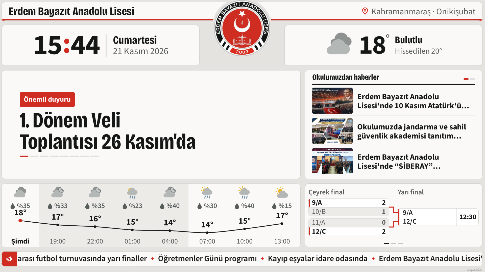

Yönetim ekranı ise panoyu hazırladığın yerdir. Sol menüde **Ana sayfa**, **İçerikler**, **Turnuvalar**, **Müzik**, **Düzen**, **Ayarlar** ve **Hakkında** vardır. **Ekle** düğmesi ve **Acil duyuru** her sayfada hazır durur.

---

## 1. Yönetime giriş

Yönetim ekranı, tahtadaki OpenBoard'a aynı okul ağındaki telefon veya bilgisayardan girmeni sağlar.

1. Tahta bilgisayarında OpenBoard penceresini aç. Pencerede yönetim adresi ve karekod yazar.
2. Telefonundan karekodu okut ya da adresi tarayıcıya yaz. Adres `/yonetim` ile biter.
3. **Şifre** alanına yönetim şifreni yaz, **Giriş yap**'a bas.
4. İlk kurulumda şifreyi sen belirlersin: en az 8 karakter yaz, **Şifre (tekrar)** alanına aynısını gir, **Şifreyi kaydet**'e bas.

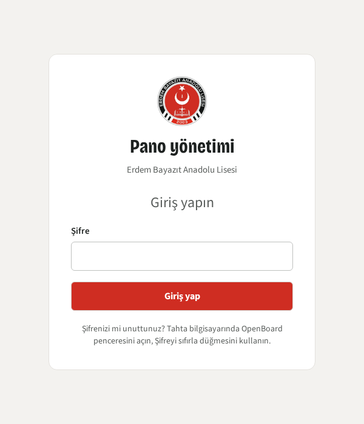

**Şifremi unuttum:** Tahta bilgisayarında OpenBoard penceresini aç ve **Şifreyi sıfırla** düğmesini kullan. Şifreni sonradan değiştirmek için [Ayarlar](#12-ayarlar) içindeki **Şifre değiştir** sekmesine bak.

> İpucu: Adresi telefonunun ana ekranına kısayol olarak ekle, her seferinde karekod okutmana gerek kalmaz.

## 2. Ana sayfa

Ana sayfa, günlük işlerin başlangıç noktasıdır: yeni duyuru, skor girişi, acil duyuru ve panonun o anki hali.

1. Soldaki menüden **Ana sayfa**'yı aç.
2. En üstteki üç düğmeden birini seç: **Duyuru ekle**, **Turnuva skoru gir** veya **Acil duyuru**.
3. **Duyurular** kutusunda yayındaki duyuruları gör. Birini değiştirmek için **Düzenle**'ye bas.
4. **Şu an yayında** kutusu, panoda sırayla dönen her şeyi ve bir turun toplam süresini gösterir. **Tümünü gör** seni **İçerikler**'e götürür.
5. **Yakında bitenler** listesinde süresi dolmak üzere olan içerikler durur. Süre uzatmak için **Süreyi uzat**'a bas; içerik 7 gün daha panoda kalır.
6. Sağdaki **Pano şu an** kutusu panonun canlı önizlemesidir. **Büyüt**'e basarak tam boy aç.
7. **Ekran durumu**, tahtanın açık olup olmadığını, hava durumu ve okul haberlerinin son güncellenme saatini gösterir. **Panodan ekran görüntüsü al** düğmesi tahtadan anlık görüntü ister.

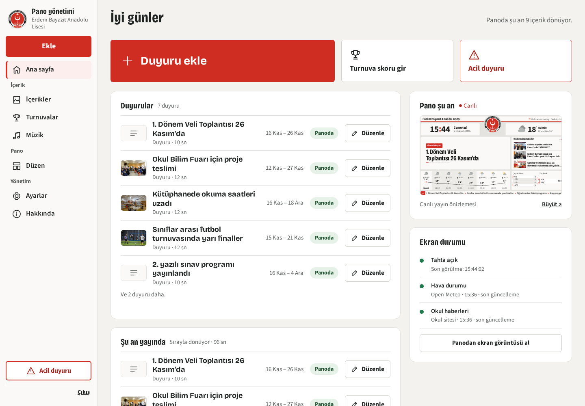

> İpucu: Sol üstteki **Panoda şu an N içerik dönüyor** yazısı, panonun kaç içerik gösterdiğini bir bakışta söyler.

## 3. Duyuru ekleme

Duyuru; başlık, kısa metin ve istersen bir resimden oluşur. Başlığı yazıp yayınlaman yeter, gerisi isteğe bağlıdır.

1. **Ekle**'ye bas (ya da Ana sayfada **Duyuru ekle**'ye), açılan pencerede **Duyuru**'yu seç.
2. İstersen **Hazır şablon** satırından **Toplantı**, **Sınav**, **Etkinlik** veya **Kayıp eşya**'yı seç; alanlar örnek metinle dolar.
3. **Başlık** alanına duyurunun adını yaz.
4. **Açıklama** alanına ayrıntıyı yaz. **Gün ve saat** ile **Yer** alanları duyurunun altında küçük bilgi satırı olarak görünür.
5. **Ne zaman başlasın** ve **Ne zaman kalksın** ile yayın aralığını seç. Bitiş tarihini boş bırakırsan duyuru sen kaldırana kadar durur.
6. Resim eklemek için **Resim ekle**'ye bas. Daha önce yüklediğin resimleri **Görsel arşivi ve gösterim süresi** başlığının altından seçebilirsin. Aynı yerden duyurunun ekranda kaç saniye kalacağını da ayarlarsın (3 ile 300 saniye arası).
7. Duyuru önemliyse **Önemli (kırmızı etiket)** anahtarını aç. **Kayan yazıda da çıksın** anahtarı duyuruyu panonun altındaki kayan yazıya da koyar.
8. **Duyuru rengi** satırından bir renk seç: **Varsayılan**, **Önemli**, **Lacivert**, **Yeşil**, **Turuncu** veya **Koyu**. Yazı rengi zemine göre kendiliğinden değişir.
9. Sağdaki önizlemede duyurunun panoda nasıl duracağını gör. **Büyük alan** ve **Köşe** düğmeleri farklı kutu boyutlarını gösterir.
10. **Yayınla**'ya bas. Hazır değilsen **Taslak olarak kaydet**'i kullan; taslak panoda görünmez.

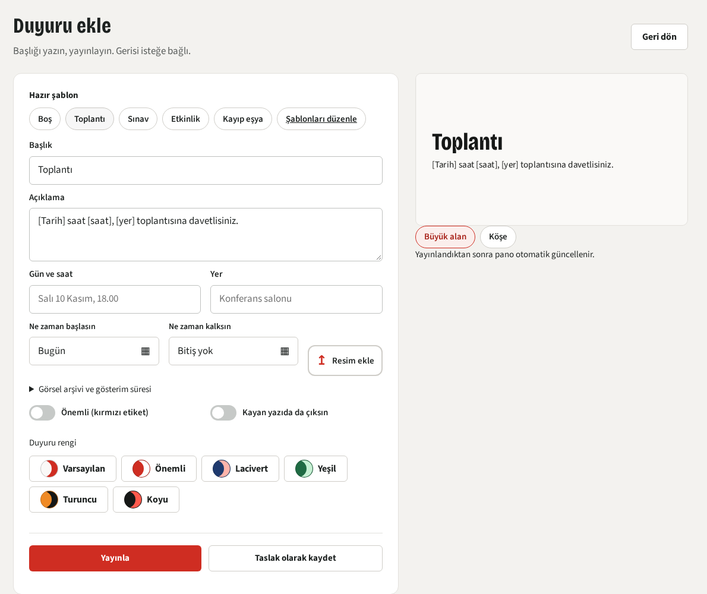

Resimli bir duyuruda ek ayarlar belirir: **Görsel yeri** (üstte, altta, solda, sağda, arka planda) ve **Görselin kapladığı alan** kaydırıcısı. **Kadraj** bölümünde resmin hangi kısmının görüneceğini çerçeveyi sürükleyerek seçersin; **Yakınlaştırma** kaydırıcısı ve **Ortala** düğmesi de oradadır.

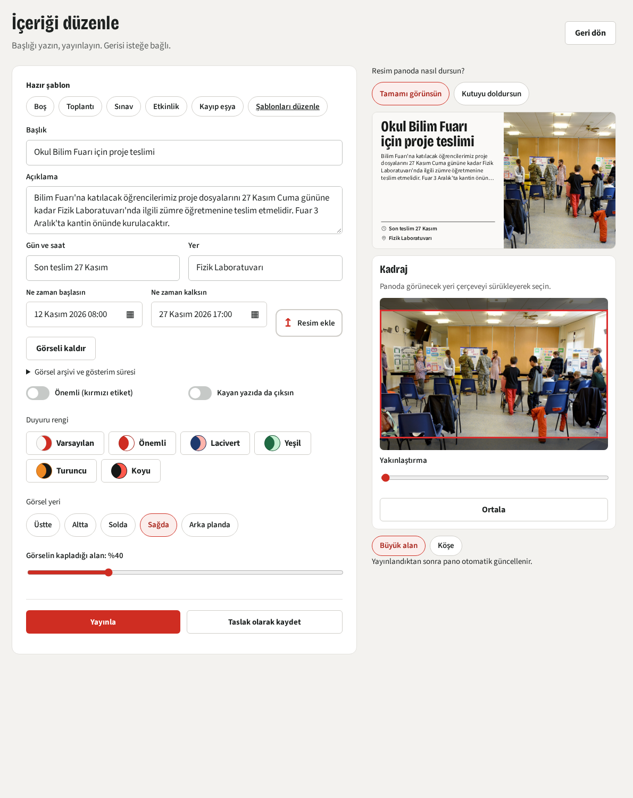

> İpucu: Metin uzunsa önizlemeye bak. Pano küçük kutuda uzun metni keser, kısa cümle her ekranda daha okunur.

## 4. Fotoğraf, video, YouTube ve sunu ekleme

Duyuru yazmadan doğrudan görsel, video, YouTube bağlantısı ya da sunu da ekleyebilirsin. Hepsi **Ekle** düğmesinden başlar.

1. Sol menüde **Ekle**'ye bas (telefonda alt çubuktaki **Ekle**). **Ne eklemek istiyorsunuz?** penceresi açılır.
2. Eklemek istediğin türü seç.

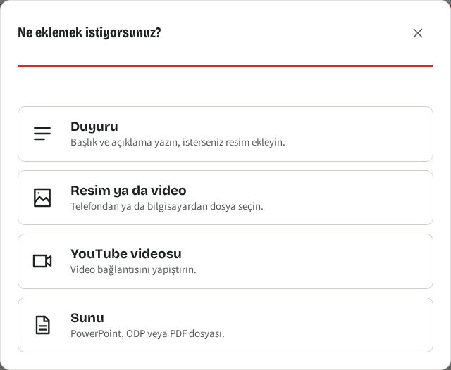

**Resim ya da video**

1. **Resim ya da video**'yu seç.
2. Dosyayı kutuya bırak ya da tıklayıp seç. Birden çok dosya seçebilirsin. Resim için JPG, PNG, WEBP; video için MP4, WEBM kullan.
3. Yükleme çubuğu **Eklendi** yazınca **Bitti**'ye bas.
4. Daha önce yüklediğin bir dosyayı yeniden kullanmak için **Daha önce yüklenenlerden seç**'e bas.

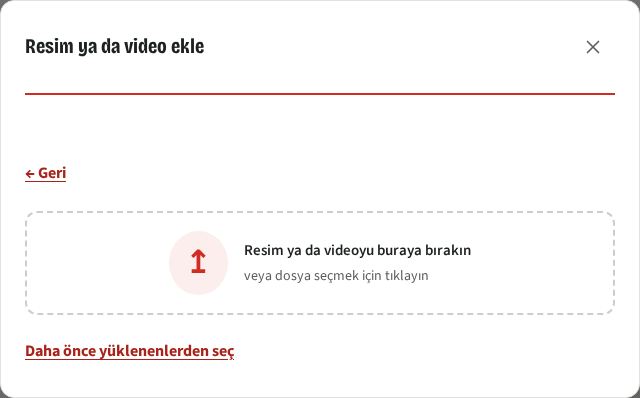

Yüklediğin resim ya da videoyu **İçerikler** sayfasından **Düzenle** ile açarsın. Orada:

- **Kadraj**: Resmin ya da videonun hangi kısmının görüneceğini çerçeveyi sürükleyerek seçersin. **Yakınlaştırma** ile çerçeveyi küçültür, **Ortala** ile ortaya alırsın. **Resim panoda nasıl dursun?** satırında **Tamamı görünsün** ya da **Kutuyu doldursun** seçilir.
- **Video kırpma**: **Başlangıç (saniye)** ve **Bitiş (saniye)** ile videonun hangi kısmının oynayacağını belirlersin. **Önizle** seçili kısmı oynatır, **Tamamını oynat** kırpmayı kaldırır. **Sesli çalsın** anahtarı video sesini açar.

**YouTube videosu**

1. **YouTube videosu**'nu seç.
2. **Video bağlantısı** alanına `youtube.com` ya da `youtu.be` ile başlayan adresi yapıştır. Doğru bağlantıda videonun küçük resmi görünür.
3. İstersen **Başlık** yaz, sonra **Ekle**'ye bas. Bağlantı YouTube'a benzemiyorsa ekran uyarır.

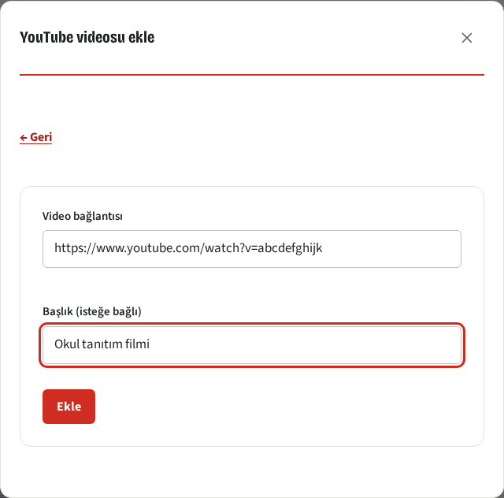

**Sunu ve PDF**

1. **Sunu**'yu seç.
2. PowerPoint (`.pptx`, `.ppt`), ODP ya da PDF dosyasını kutuya bırak. OpenBoard dosyayı sayfa sayfa resme çevirir.
3. Yükleme bitince **Bitti**'ye bas.
4. **İçerikler**'de sunuyu bul. Her sayfanın kaç süre kalacağını sunu satırında ayarlarsın: tek bir süre yaz (saniye ya da dakika) ya da **Sayfa sayfa ayarla** ile her sayfaya ayrı süre ver. Boş bıraktığın sayfa genel süreyi kullanır.

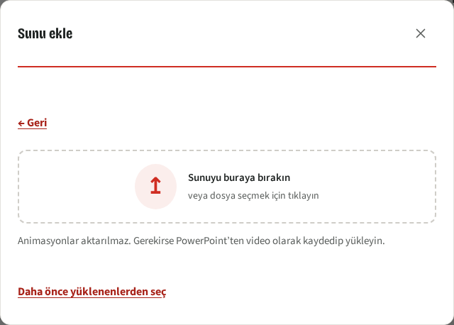

> İpucu: Sunudaki animasyonlar aktarılmaz. Animasyonlu sunuyu PowerPoint'ten video olarak kaydedip **Resim ya da video** ile yükle.

## 5. İçerikler

İçerikler, panoya koyduğun her şeyin deposudur: duyurular, resimler, videolar, YouTube bağlantıları, sunular ve turnuvalar. Sıra buradaki sıradır.

1. Soldaki menüden **İçerikler**'i aç.
2. Üstteki etiketlerle listeyi süz: **Panoda**, **Taslak**, **Zamanı gelecek**, **Süresi geçmiş**. Her etiketin yanında kaç içerik olduğu yazar.
3. **Ara** kutusuna içeriğin adından bir parça yaz; liste anında daralır.
4. Sırayı değiştirmek için içeriği tutup sürükle ya da satırdaki yukarı ve aşağı oklarını kullan. Pano içerikleri bu sırayla gösterir.
5. **Panoda göster** anahtarı içeriği silmeden panodan çıkarır ve geri koyar.
6. Satırın altındaki **Değiştir** bağlantısı gösterim zamanını açar: **Her zaman**, **Şu tarihler arası** veya **Belirli gün ve saatler**.
7. İçeriği değiştirmek için **Düzenle**'ye bas. **Sil** içeriği kaldırır; basmadan önce emin ol.
8. **Kullanıldığı yerler** satırı, içeriklerin hangi kutuda döndüğünü gösterir. **Düzen'de düzenle** bağlantısı seni o kutuya götürür.

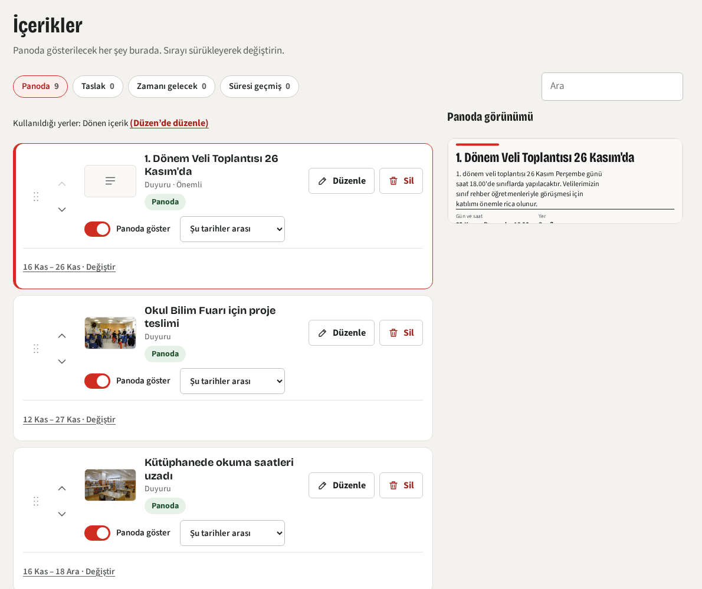

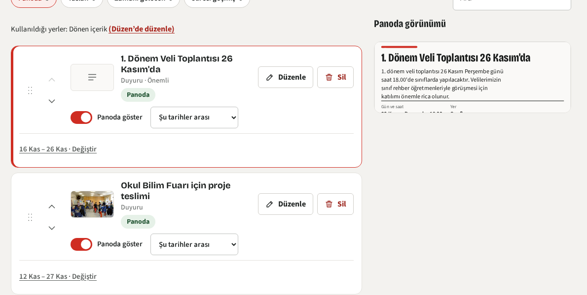

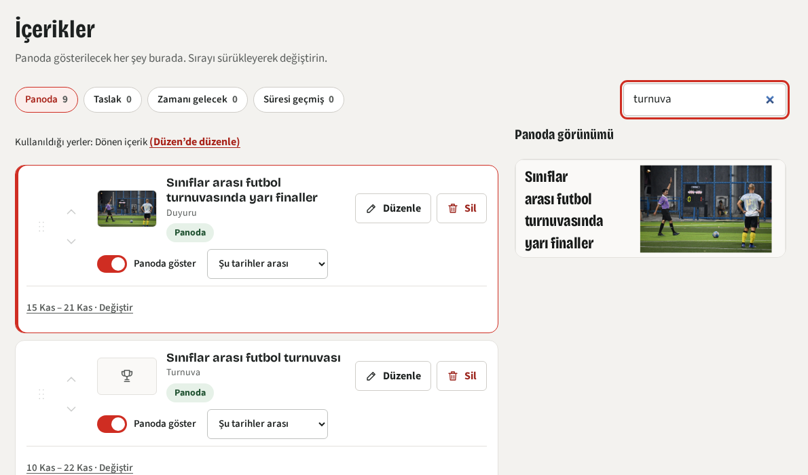

> İpucu: Duyuruyu silmek yerine **Panoda göster** anahtarını kapat. Gelecek yıl aynı duyuruyu yeniden yazmak zorunda kalmazsın.

## 6. Düzen

Düzen, panonun ekranda nasıl bölündüğünü belirler: hangi kutu nerede, ne kadar büyük, ne zaman görünür. Her kutu saat, hava, dönen içerik gibi ayrı bir parçadır.

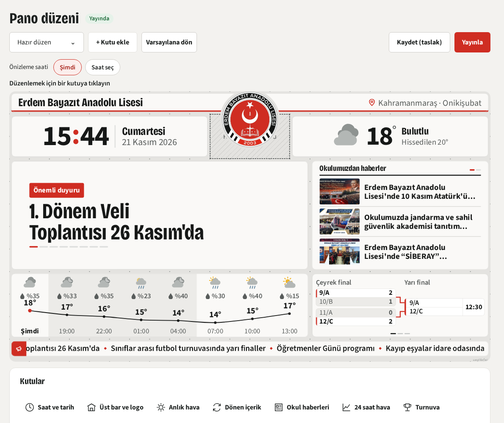

**Kutu ekleme ve yerleştirme**

1. Soldaki menüden **Düzen**'i aç.
2. **+ Kutu ekle**'ye bas ve listeden bir kutu seç. Kutu, ilk boş yere konur. Boş yer yoksa "Yeterli boş alan yok" uyarısı çıkar; önce başka bir kutuyu kaldır ya da küçült.
3. Kutuyu taşımak için önizlemede tutup sürükle. Boyutlandırmak için kenarındaki ok tutamaçlarını (yatay, dikey, köşe) sürükle.
4. Hazır bir düzenle başlamak için **Hazır düzen** menüsünden **Ortada taşan logo** ya da **Bar içinde logo**'yu seç.
5. **Varsayılana dön** düzeni okulun başlangıç düzenine çevirir. Bu, taslağı değiştirir; **Yayınla**'ya basana kadar panoya yansımaz.

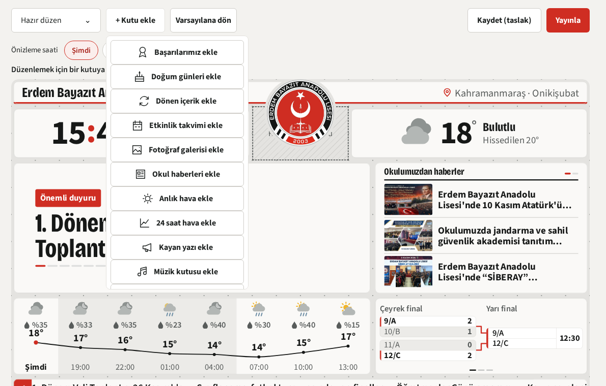

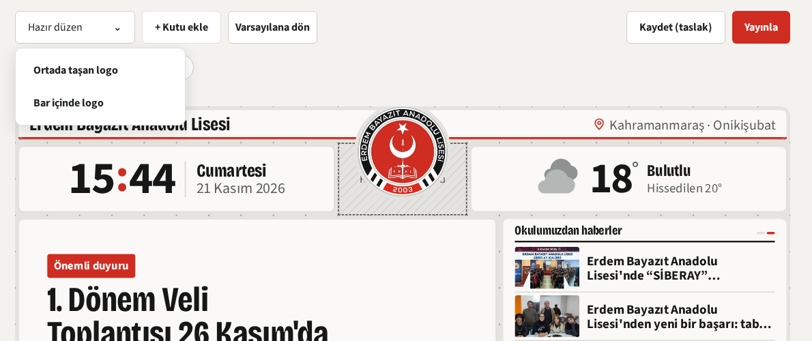

**Kutu paneli**

Önizlemede bir kutuya tıklayınca altta o kutunun paneli açılır. Panelde üç sütun vardır.

1. **İçerik**: Kutunun neyi göstereceği. **Dönen içerik** kutusunda iki seçenek vardır: **Tüm içerikler** (panodaki bütün içerikleri İçerikler sayfasındaki sırayla gösterir) ve **Seçtiklerim**. **Seçtiklerim**'de kutuda dönecek içerikleri seçer, sırasını okla ya da sürükleyerek değiştirir ve her birine süre (sn) yazarsın. Satırın sağındaki ✕ içeriği o kutudan çıkarır.
2. **Boyut**: **Küçük**, **Orta**, **Büyük** ya da **Varsayılan**. Hangi boyutların çıktığı kutuya göre değişir. Elle ayarlamak için **Gelişmiş · konum ve boyut**'u aç.
3. **Görünüm**: **Ne zaman görünsün** seçenekleri. Aşağıda anlatılıyor.

Kutuyu düzenden çıkarmak için panelin altındaki **Kaldır**'a bas.

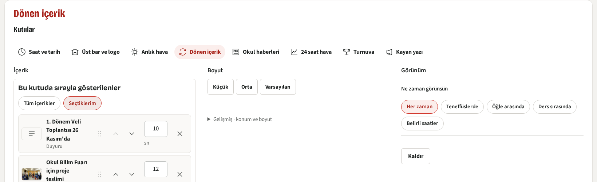

**Zamana göre görünme**

**Ne zaman görünsün** altındaki seçenekler kutunun hangi saatlerde görüneceğini belirler:

- **Her zaman**: Kutu sürekli görünür.
- **Teneffüslerde**: Zil saatlerindeki teneffüslerde görünür.
- **Öğle arasında**: Yalnız öğle arasında görünür.
- **Ders sırasında**: Yalnız ders saatlerinde görünür.
- **Belirli saatler**: Başlangıç ve bitiş saati yazarsın.

Bu seçenekler [Ayarlar](#12-ayarlar) içindeki **Zil saatleri**'ne bağlıdır.

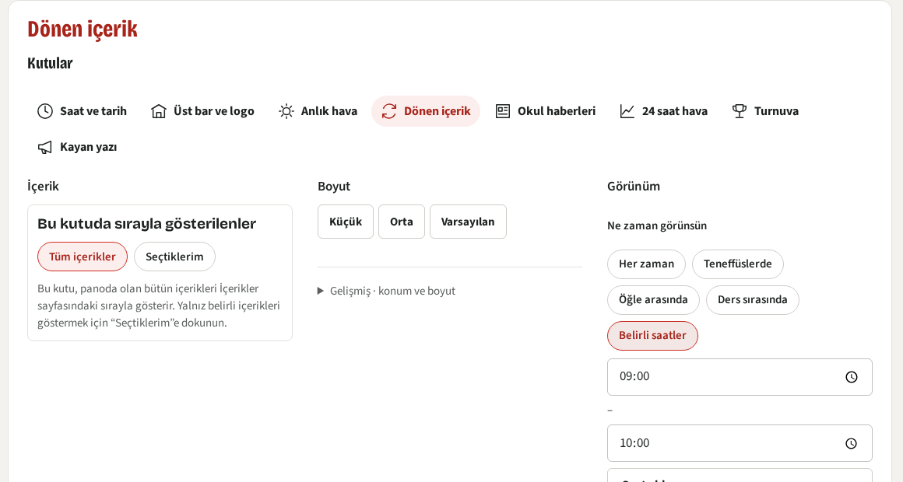

**Önizleme saati**

Kutuların belirli bir saatte nasıl görüneceğini denemek için **Önizleme saati** satırında **Saat seç**'e bas ve bir saat yaz. Önizleme o saate göre çizilir. **Şimdi** gerçek saate döner. Bu yalnız önizlemedir, panoyu etkilemez.

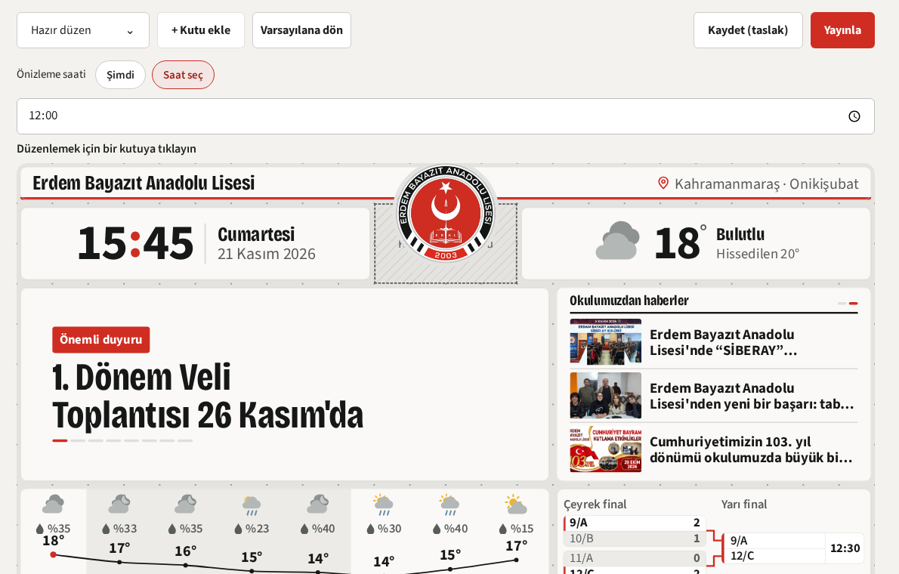

**Kaydet ve yayınla**

1. Düzeni değiştirince başlığın yanında "Taslak · yayınlanmamış değişiklik var" yazar.
2. **Kaydet (taslak)** değişikliği saklar ama panoya göndermez. İşin yarım kaldıysa kullan.
3. **Yayınla** düzeni panoya gönderir. Pano birkaç saniye içinde yeni düzeni gösterir.

> İpucu: Büyük bir değişiklikten önce **Kaydet (taslak)** ile ilerle, önizlemede kontrol et, sonra **Yayınla**'ya bas. Yanlış olursa [Geçmiş](#13-geçmiş-ve-geri-alma) sayfasından önceki düzene dönersin.

## 7. Ek kutular

Ek kutular, kendi verini girdiğin kutulardır. Verinin girildiği yer **Düzen** sayfasındaki kutu panelidir.

1. **Düzen**'i aç, **+ Kutu ekle**'ye bas ve ek kutuyu seç. Kutu önizlemede belirir ve paneli açılır.
2. **İçerik** sütununda satırları doldur. Yeni satır için **Satır ekle**, silmek için **Satırı sil**'e bas.
3. **Verileri kaydet**'e bas. Veriler hemen kaydedilir.
4. Kutuyu panoda görmek için **Yayınla** ile düzeni de yayınla.

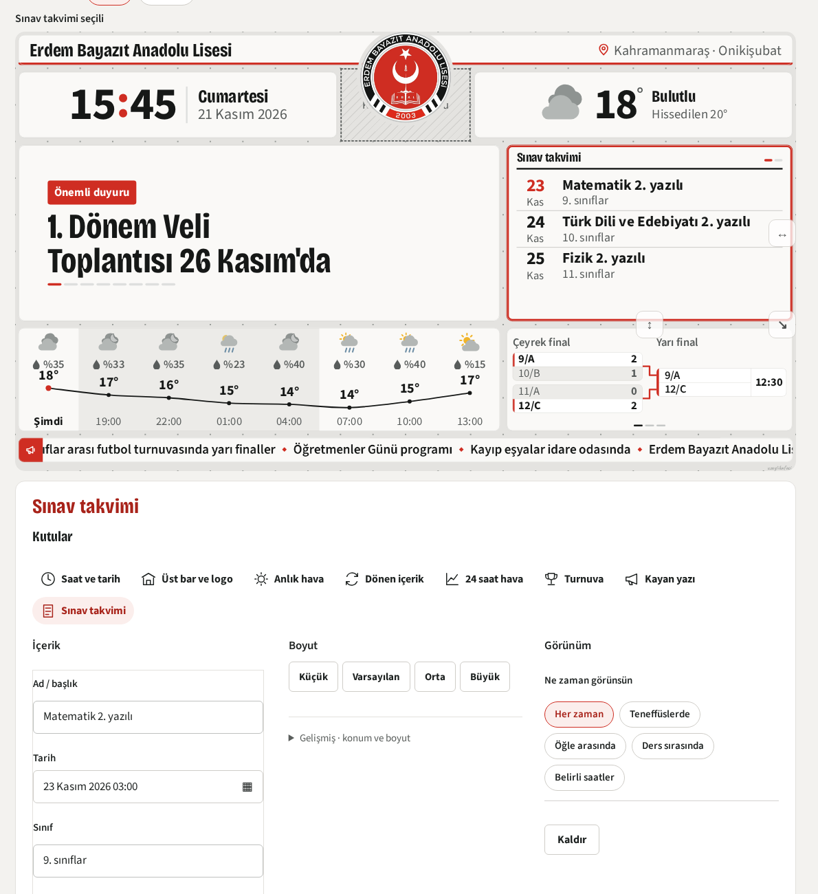

Kutular şunlardır:

| Kutu | Ne gösterir | Satırda doldurduğun alanlar |
|---|---|---|
| Nöbetçi öğretmenler | Günlere göre nöbet listesi | Ad / başlık, Yer, Gün |
| Sınav takvimi | Yaklaşan sınavlar | Ad / başlık, Tarih, Sınıf, Saat (isteğe bağlı) |
| Geri sayım | Bir tarihe kalan gün | Ad / başlık, Tarih |
| Günün sözü | Bir söz ve sahibi | Metin, Ad / başlık |
| Etkinlik takvimi | Yaklaşan okul etkinlikleri | Ad / başlık, Tarih, Saat (isteğe bağlı), Yer |
| Başarılarımız | Öğrenci başarıları | Ad / başlık, Derece, Sınıf, Metin, Fotoğraf (isteğe bağlı) |
| Doğum günleri | Doğum günü olanlar | Ad / başlık, Tarih |
| Fotoğraf galerisi | Dönen fotoğraflar | Ad / başlık, Fotoğraf |
| Karekod | Bir bağlantının karekodu | Bağlantı, Başlık |

**Nöbetçi öğretmenler:** Her satıra bir öğretmen, nöbet yeri ve günü yaz.

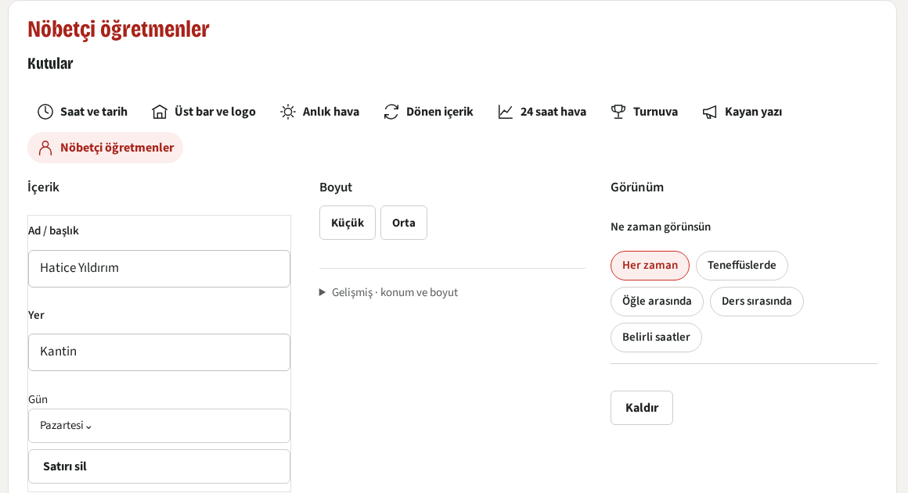

**Sınav takvimi:** Tarih alanına takvim simgesiyle gün ve saat seç.

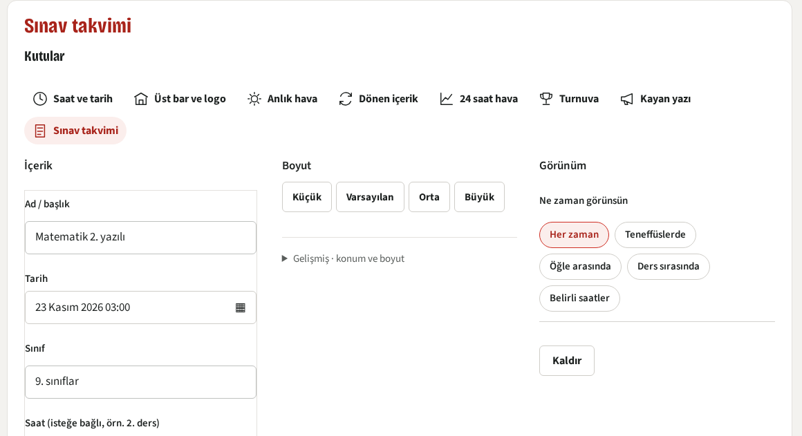

**Geri sayım:** Bir tarihe kalan süreyi gösterir. Karne günü ya da tatil gibi bir tarih için kullan.

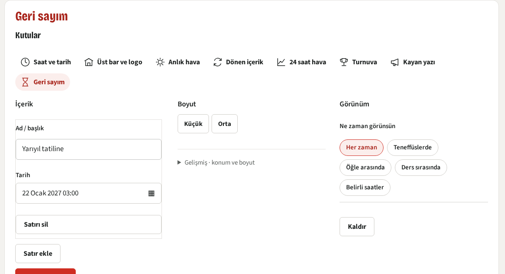

**Günün sözü:** Uzun sözler küçük kutularda kısalır, kısa söz seç ya da kutuyu büyüt.

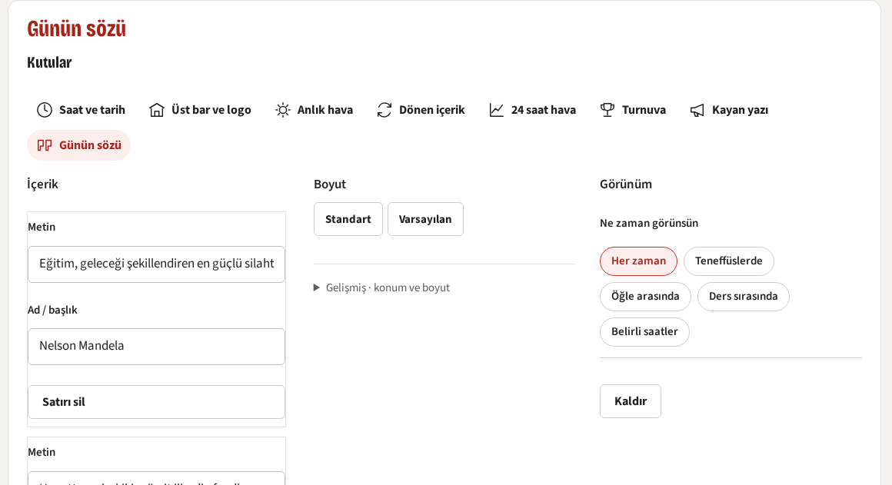

**Etkinlik takvimi:** Tarih, istersen saat ve yer yaz.

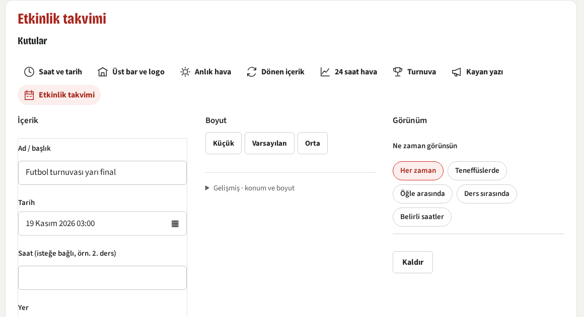

**Başarılarımız:** Fotoğrafı depodan seçersin. Depoda fotoğraf yoksa önce **İçerikler** sayfasından yükle.

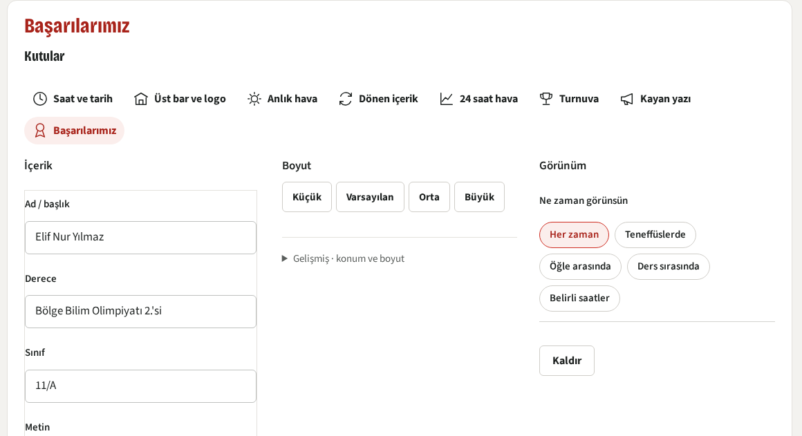

**Doğum günleri:** Ad ve doğum tarihini yaz. Kutu o gün doğum günü olanı gösterir.

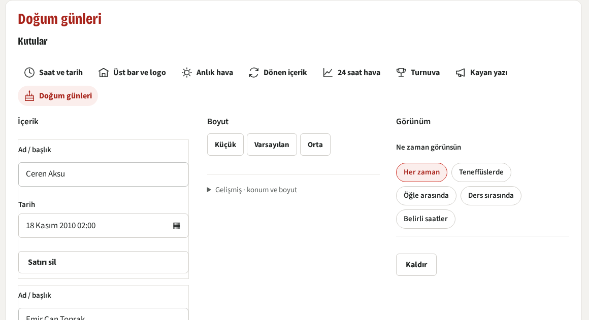

**Fotoğraf galerisi:** Fotoğraflar depodan seçilir. **Küçük resimleri göster** anahtarı galerinin altına küçük resim şeridi koyar.

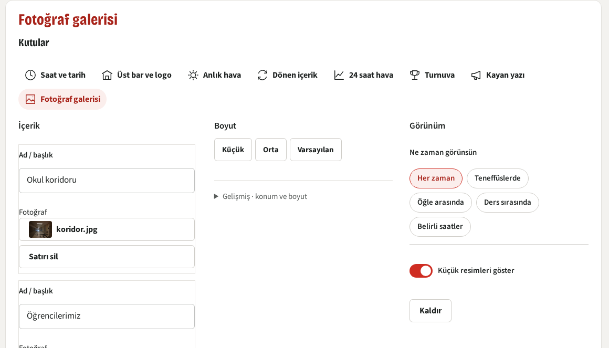

**Karekod:** **Bağlantı** alanına okul sitesi ya da form adresini yaz, **Başlık** alanına karekodun altında görünecek yazıyı gir. Karekodu öğrenci ya da veli telefonuyla okutur.

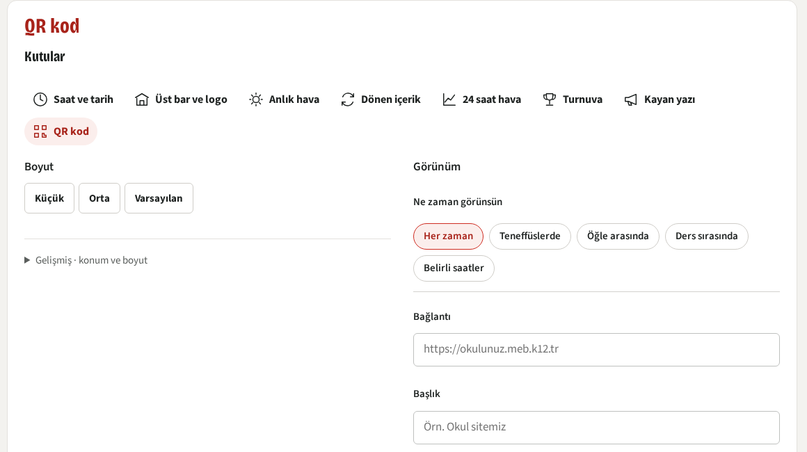

Veri girmen gerekmeyen kutular da vardır: **Saat ve tarih**, **Üst bar ve logo**, **Anlık hava**, **24 saat hava**, **Okul haberleri**, **Ders zili** (veriyi **Ayarlar > Zil saatleri**'nden alır) ve **Kayan yazı**. **Müzik kutusu** çalma listesini [Müzik](#10-müzik) sayfasından alır.

> İpucu: Kutu paneline girmeden önce **Satır ekle** ile bir örnek satır yaz, önizlemede kutunun nasıl göründüğüne bak, sonra gerçek veriyi gir.

## 8. Takvim

Takvim, hangi içeriğin hangi gün ve saatte panoda olduğunu tek bakışta gösterir. Çakışmaları ve gereğinden uzun dönüşleri buradan yakalarsın.

1. **Ayarlar**'ı aç, **Yayın takvimi** sekmesine bas.
2. Üstteki **Hafta** ve **Ay** düğmeleriyle görünümü seç. ‹ ve › oklarıyla önceki ve sonraki döneme geç, **Bu hafta** ile bugüne dön.
3. Her satır bir kutudur (**Dönen içerik**, **Turnuva**, **Kayan yazı** gibi). Satırdaki çubuklar içeriklerin hangi günlerde ve saatlerde göründüğünü gösterir.
4. Kırmızı sütun bugündür.
5. **Bir turun süresi** satırı, o günkü içerik dönüşünün kaç dakika sürdüğünü gösterir.
6. Sayfanın altındaki uyarılara bak: **Önemli duyuru çakışması** bir günde üç ya da daha fazla önemli duyuru olduğunda, **Tur süresi** dönüş çok uzadığında uyarır.

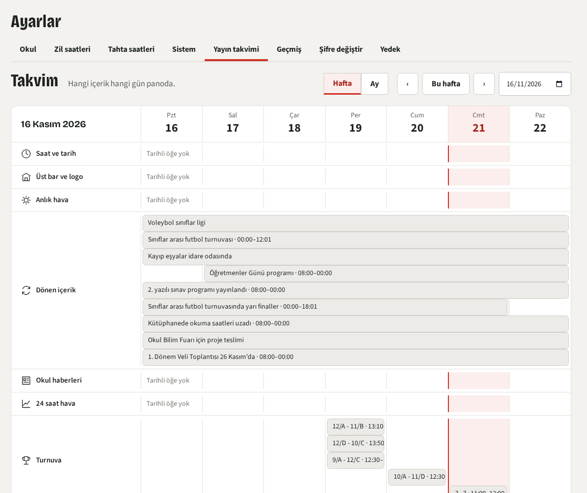

> İpucu: Tur 2 dakika 30 saniyeyi geçerse izleyen kişi aynı duyuruyu görmek için çok bekler. Gereksiz içeriği kaldır ya da sürelerini kısalt.

## 9. Turnuvalar

Turnuva sayfası, okulda yapılan maçların fikstürünü oluşturur ve skorları panoda gösterir. Skor girdikçe tablo kendiliğinden ilerler.

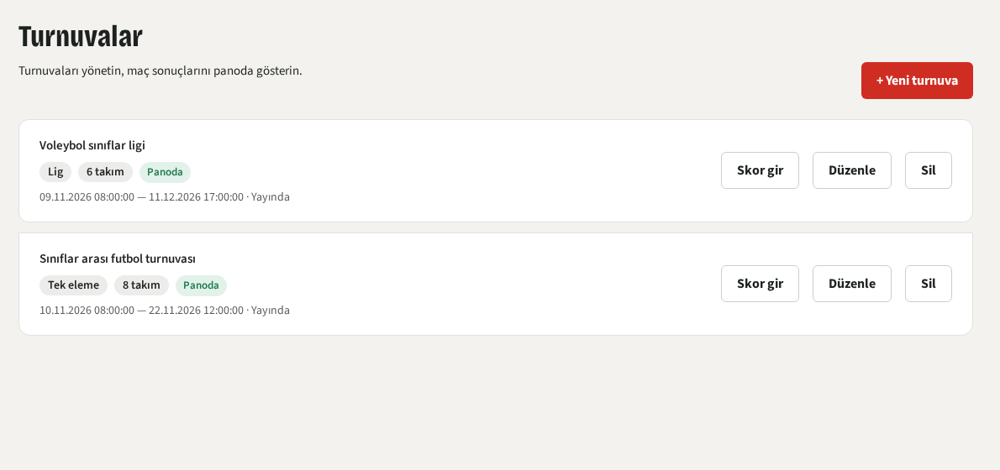

**Turnuva oluşturma**

1. Soldaki menüden **Turnuvalar**'ı aç ve **+ Yeni turnuva**'ya bas.
2. **1. Tür** adımında bir tür seç:
   - **Tek eleme**: Kaybeden elenir, kazanan bir üst tura geçer.
   - **Çift eleme**: İki yenilgiyle elenme; gerektiğinde final tekrarı.
   - **Lig**: Her takım diğerleriyle karşılaşır.
   - **Grup + eleme**: Grup maçlarından sonra eleme şeması.
3. **Devam**'a bas.

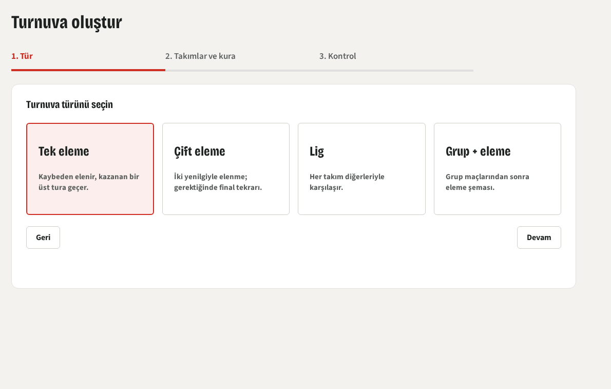

4. **2. Takımlar ve kura** adımında **Başlık** alanına turnuvanın adını yaz.
5. Takım adlarını yaz. Yeni takım için **+ Takım ekle**'ye bas, sırayı değiştirmek için ⠿ tutamacından sürükle, bir takımı çıkarmak için ✕'e bas.
6. Takımları rastgele sıralamak için **Karıştır (kura çek)**'e bas. Elle yazdığın sıra korunur, kura isteğe bağlıdır.
7. **Devam**'a bas.

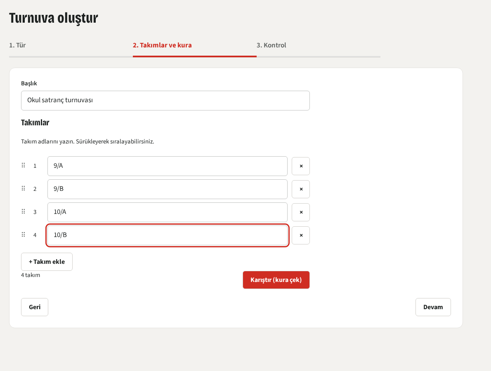

8. **3. Kontrol** adımında turnuva adını, takım sayısını ve ilk karşılaşmaları kontrol et.
9. Her şey doğruysa **Yayınla**'ya bas. Yanlış varsa **Geri** ile düzelt.

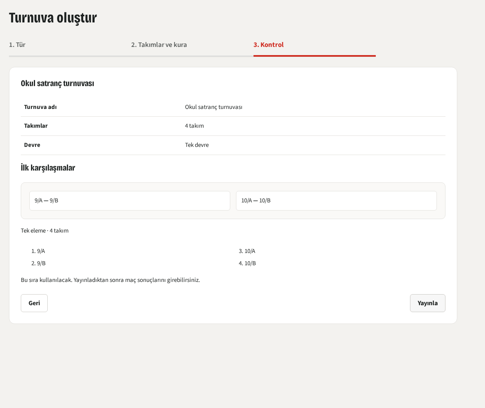

**Skor girme**

1. **Turnuvalar** sayfasında turnuvanın yanındaki **Skor gir**'e bas. (Ana sayfadaki **Turnuva skoru gir** de buraya götürür.)
2. Maçın takımlarının yanındaki **−** ve **+** düğmeleriyle skoru yaz.
3. Maç tarihi ve saati için **Tarih** ve **Saat** alanlarını doldur. Saati silmek için **Saati sil**'e bas.
4. Maçın yanındaki **Kaydet**'e bas. Maç kaydedilince "✓ Kaydedildi" yazar ve kazanan bir üst tura geçer.
5. Sağdaki **Canlı pano önizlemesi** ve **Aşama ilerlemesi** kutusundan turnuvanın durumunu izle.

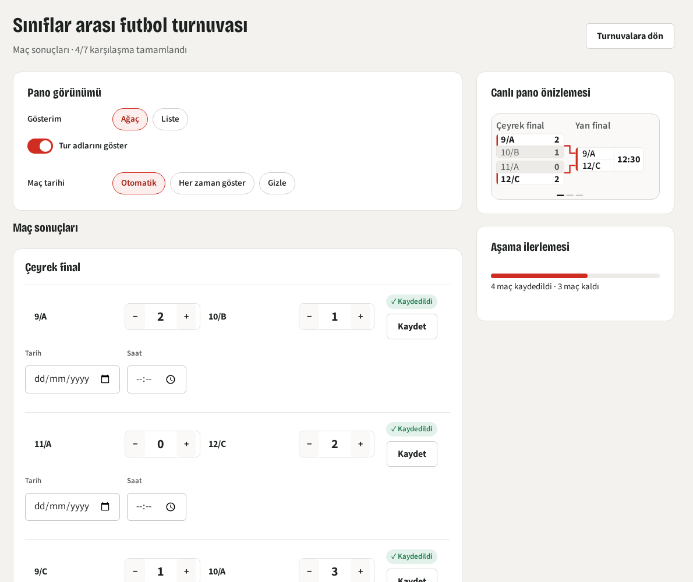

**Kutuda gösterim**

Turnuvanın panoda nasıl görüneceğini iki yerden ayarlarsın: skor ekranındaki **Pano görünümü** bölümünden ya da **Düzen**'de **Turnuva** kutusunun panelinden.

1. **Hangi turnuva** listesinden turnuvayı seç. **En son turnuva** seçili kalırsa kutu hep en yeni turnuvayı gösterir.
2. **Ana gösterim** için birini seç: **Ağaç** (lig ve grup turnuvalarında **Tablo**), **Turlara göre liste** ya da **Yaklaşan maçlar listesi**.
3. **Bölümler** altında **Yaklaşan maçlar**, **Son sonuçlar** ve (lig ile grup turnuvalarında) **Lig tablosu** anahtarlarıyla kutuya ek bölüm ekle.
4. **Tur adlarını göster** anahtarı Çeyrek final, Yarı final gibi başlıkları açar ve kapatır.
5. **Maç tarihi** için **Otomatik**, **Her zaman göster** ya da **Gizle**'yi seç.

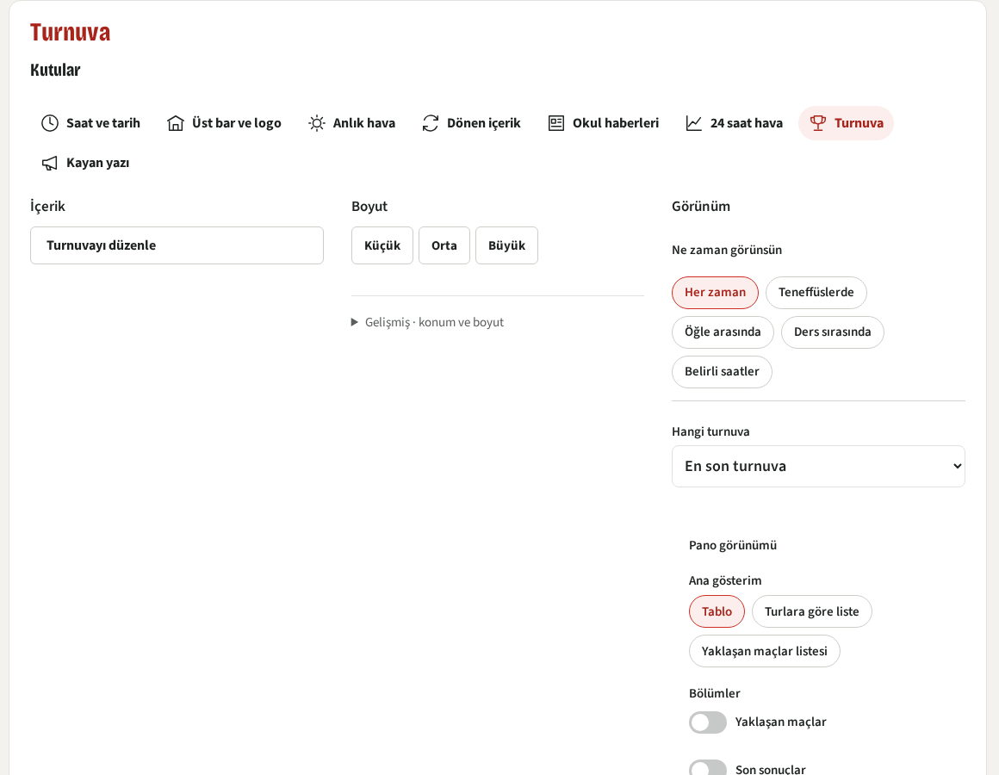

> İpucu: Ağaç görünümü küçük kutuda sıkışır. Kutu küçükse **Turlara göre liste**, büyükse **Ağaç** seç.

## 10. Müzik

Müzik sayfası, panodan teneffüslerde ve istediğin saat aralıklarında müzik çalmanı sağlar. Çalma sesi tahtadaki bilgisayardan çıkar.

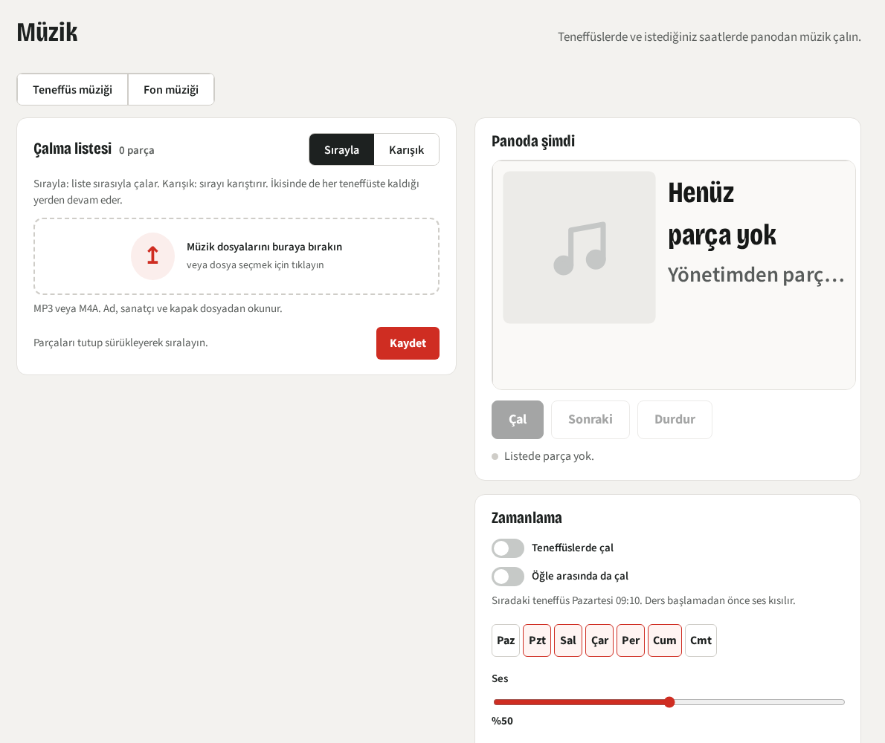

**Teneffüs müziği**

1. Soldaki menüden **Müzik**'i aç, **Teneffüs müziği** sekmesinde kal.
2. **Çalma listesi**'ne MP3 ya da M4A dosyalarını bırak ya da tıklayıp seç. Ad, sanatçı ve kapak resmi dosyadan okunur.
3. Parçaları tutup sürükleyerek sırala. **Sırayla** liste sırasıyla, **Karışık** karıştırarak çalar. İkisinde de her teneffüste kaldığı yerden devam eder.
4. **Zamanlama** kutusunda **Teneffüslerde çal** anahtarını aç. Öğle arasında da çalsın istersen **Öğle arasında da çal**'ı aç.
5. **Paz**, **Pzt**, **Sal**, **Çar**, **Per**, **Cum**, **Cmt** düğmeleriyle müziğin çalacağı günleri seç.
6. **Ses** kaydırıcısıyla ses düzeyini ayarla. Ders başlamadan önce ses kısılır.
7. **Kaydet**'e bas.
8. **Panoda şimdi** kutusunda **Çal**, **Sonraki** ve **Durdur** düğmeleriyle çalmayı deneyebilirsin.

**Fon müziği**

Fon müziği, teneffüs dışında belirlediğin saat aralıklarında çalan sakin müziktir.

1. **Fon müziği** sekmesini aç.
2. Parçaları yükle ve **Fon müziği açık** anahtarını aç.
3. **Saat aralığı ekle**'ye bas, başlangıç ve bitiş saatini yaz. İstediğin kadar aralık ekleyebilirsin.
4. Çalacağı günleri seç ve **Kaydet**'e bas.
5. Teneffüs müziği başlayınca fon müziği kısılıp susar.

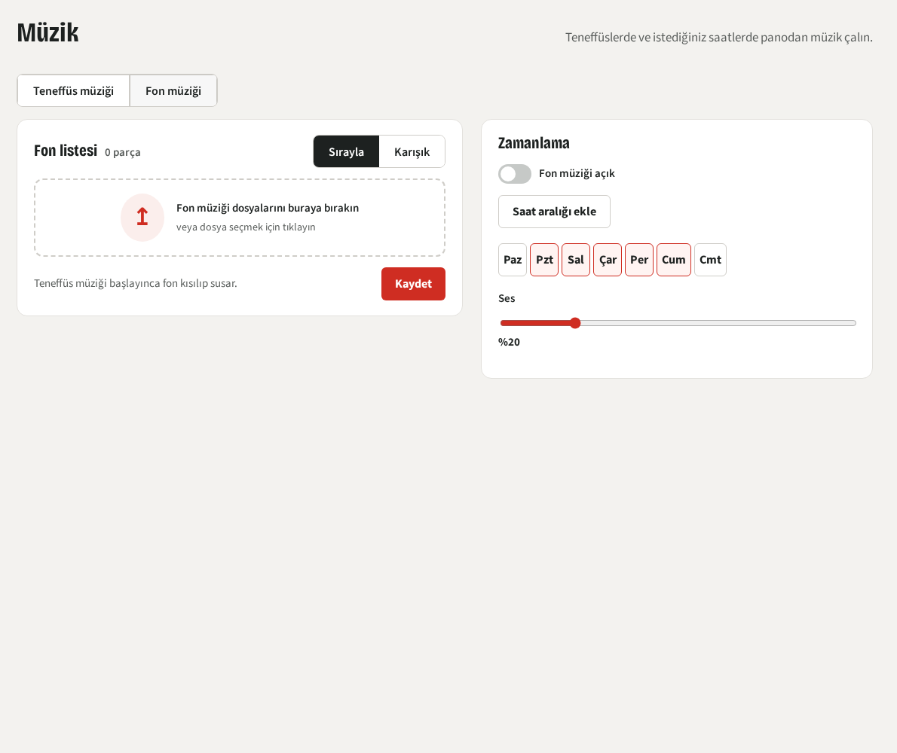

> İpucu: Müzik kutusunu panoda göstermek istersen **Düzen**'e **Müzik kutusu** ekle. Kutu çalan parçayı, kapağı ve sıradakileri gösterir.

## 11. Acil duyuru

Acil duyuru, tüm panonun yerine geçer ve yazdığın metni bütün ekranda gösterir. Yalnız acil durumlarda kullan.

1. **Acil duyuru** düğmesine bas. Düğme sol menüde, Ana sayfada ve telefonda her yerde bulunur.
2. **Acil duyuru metni** alanına mesajı yaz ya da **Hazır cümleler**'den birini seç.
3. **Ne kadar kalsın** satırından süreyi seç: **5 dk**, **15 dk**, **30 dk**, **1 saat** ya da **Elle kapatılana kadar**.
4. Sağdaki **Canlı acil pano önizlemesi**nde duyurunun nasıl görüneceğine bak.
5. **Acil duyuruyu aç**'a bas. Duyuru birkaç saniye içinde bütün ekranı kaplar.
6. Durum geçince **Acil duyuruyu kapat**'a bas. Süre seçtiysen duyuru kendiliğinden kalkar.

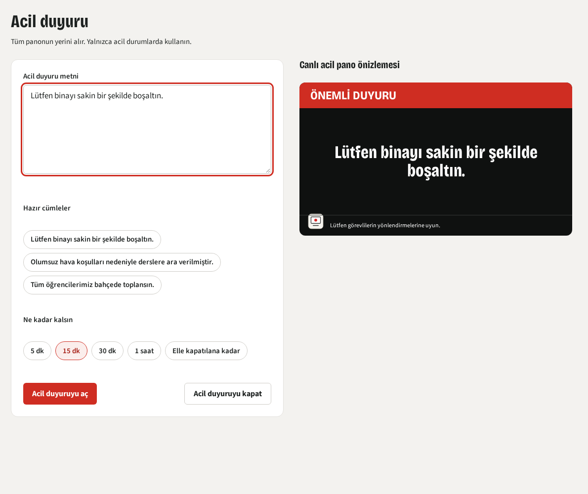

> İpucu: Acil duyuru yayındayken pano normal içeriği göstermez. Süreyi gereğinden uzun seçme.

## 12. Ayarlar

Ayarlar, okulun bilgilerini, zil saatlerini, tahtanın çalışma saatlerini, şifreyi ve yedeği toplar. Üstte sekmeler vardır: **Okul**, **Zil saatleri**, **Tahta saatleri**, **Sistem**, **Yayın takvimi**, **Geçmiş**, **Şifre değiştir**, **Yedek**. **Yayın takvimi** ve **Geçmiş** ayrı bölümlerde anlatılır ([Takvim](#8-takvim), [Geçmiş](#13-geçmiş-ve-geri-alma)).

**Okul**

1. **Okul bilgileri** altında **Okul adı**, **İl**, **İlçe** alanlarını doldur. Ad panonun üst barında görünür.
2. **İnternet sitesi / haber kaynağı** alanına okul sitesinin adresini yaz. **Önizle** ile haberlerin geldiğini kontrol et. Okul haberleri bu adresten alınır.
3. **Hava durumu konumu** için **Enlem, boylam** yaz ya da adresi yazıp **Adresten bul**'a bas.
4. **Özel ad sözlüğü ve gösterim süresi** başlığı, özel adların panoda nasıl yazılacağını ve ne kadar süre kalacağını ayarlamak içindir.
5. **Okul logosu** kutusunda **Logoyu değiştir** ile PNG, JPG, SVG ya da WEBP yükle (en çok 2 MB, kare görsel en iyisi). **Varsayılana dön** logoyu sıfırlar.
6. **Kaydet**'e bas.

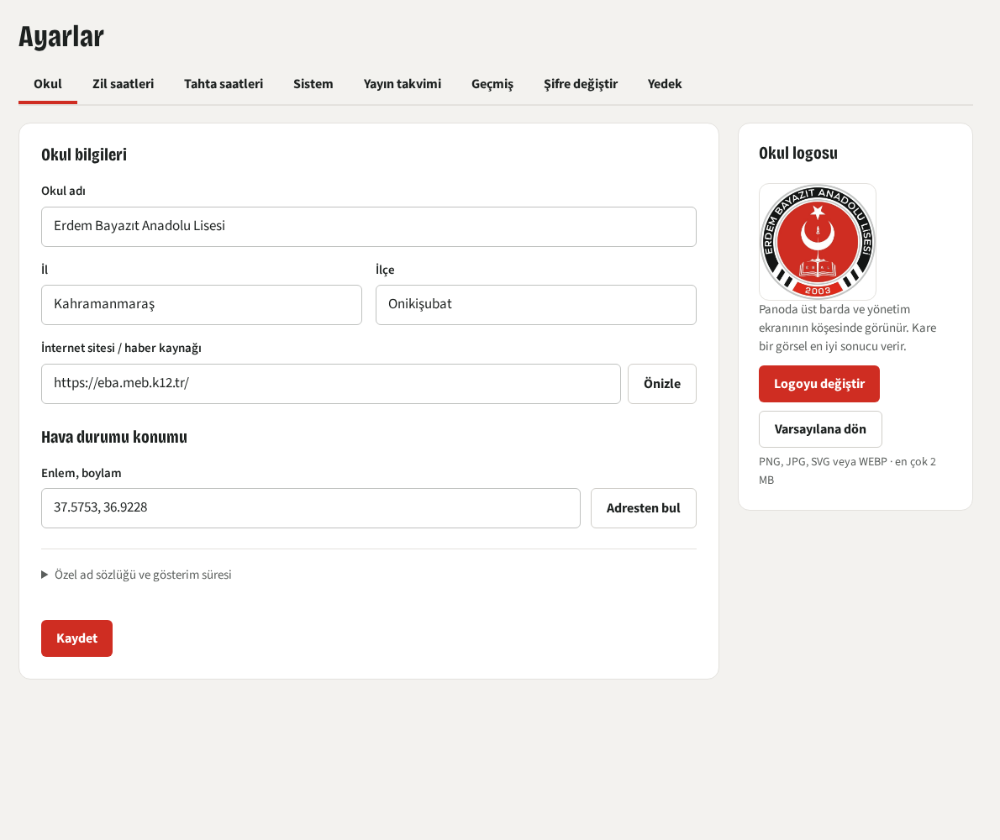

**Zil saatleri**

1. **Zil saatleri** sekmesinde **Hafta içi** programını doldur: her ders için **Başlangıç** ve **Bitiş**.
2. **Sonraki teneffüs** süresi kendiliğinden hesaplanır.
3. Yeni ders için **+ Ders ekle**, bir dersi silmek için **Sil**'e bas.
4. Cuma günü farklıysa **Cuma programı ekle**'ye bas ve **Cuma** sekmesini doldur.
5. **Kaydet**'e bas.

Bu saatler, **Teneffüslerde**, **Öğle arasında** ve **Ders sırasında** seçeneklerinin ve ders zili kutusunun dayanağıdır.

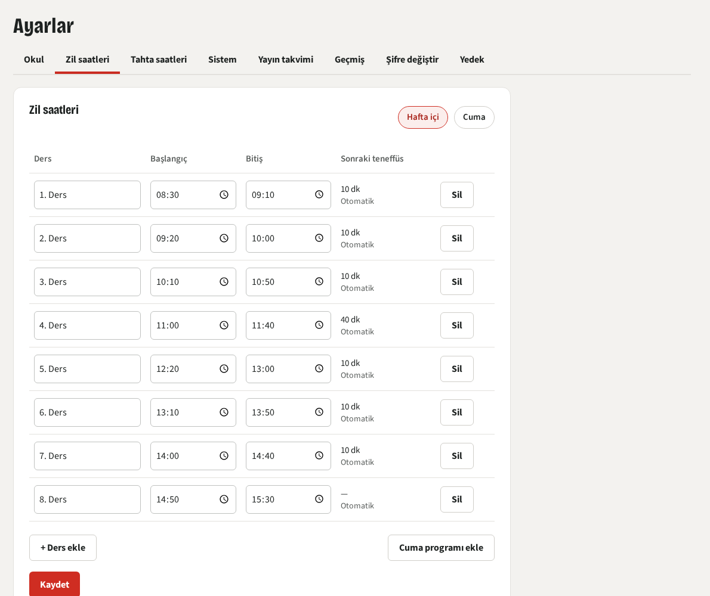

**Tahta saatleri**

1. **Tahta saatleri** sekmesinde **Genel ses düzeyi** kaydırıcısıyla panonun sesini ayarla.
2. **Pano açılış saati** ve **Pano kapanış saati** alanlarına tahtanın açık kalacağı saatleri yaz.
3. **Gelişmiş** başlığını aç. Burada video dönüştürücü, LibreOffice ve Poppler programlarının yolları durur (**Video dönüştürücü yolu**, **LibreOffice yolu**, **Poppler pdftoppm yolu**, **Poppler pdfinfo yolu**). Video ve sunu dönüşümü çalışmıyorsa yolları buraya elle yaz.
4. **Kaydet**'e bas.

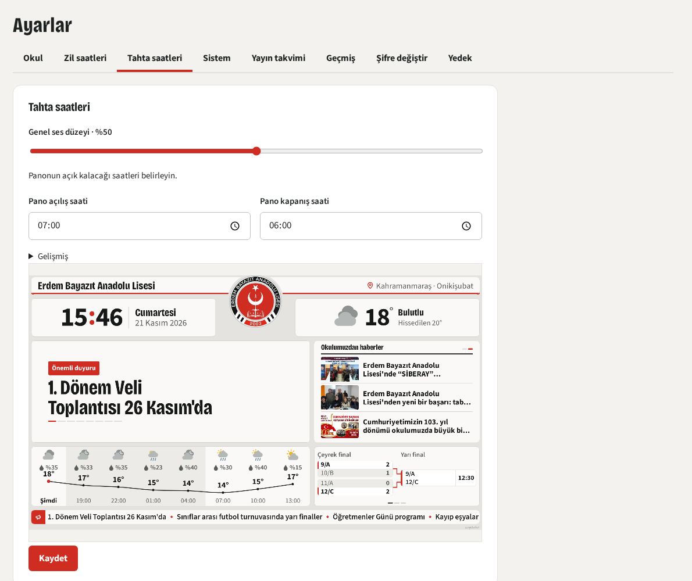

**Sistem**

**Sistem** sekmesinde **Ek programlar** (**Yeniden ara** ile eksik programları tekrar arar), **Güncelleme** (**Güncellemeleri denetle**) ve **Masaüstüne kısayol ekle** düğmeleri vardır. Güncelleme ve kısayol düğmeleri yalnız masaüstü uygulamasında çalışır.

**Şifre değiştir**

1. **Şifre değiştir** sekmesini aç.
2. **Eski şifre** alanını, sonra iki kez **Yeni şifre** alanını doldur.
3. **Şifreyi değiştir**'e bas.

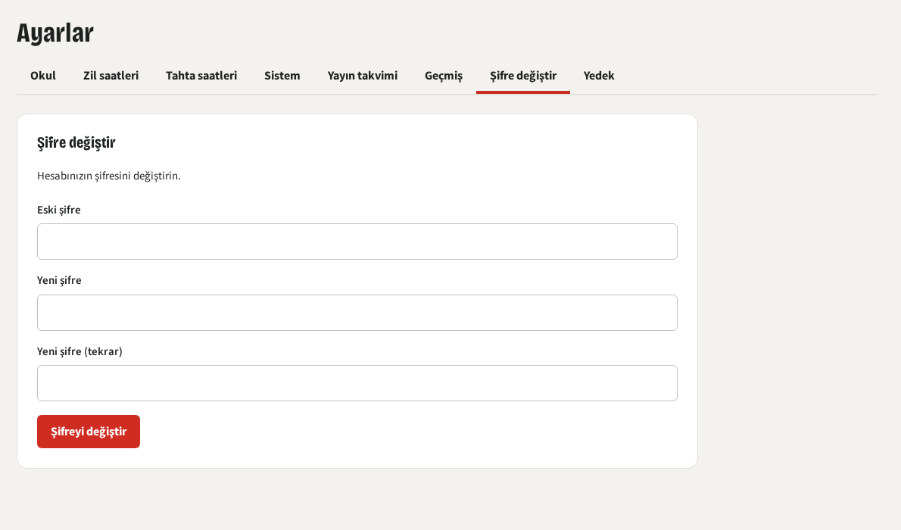

**Yedek ve geri yükleme**

1. **Yedek** sekmesinde **Yedeği indir**'e bas. İçerikler, ayarlar ve medya tek dosya olarak iner. Dosyayı güvenli bir yerde sakla.
2. **Son yedek** satırı en son alınan yedeğin zamanını gösterir. **Otomatik haftalık yedek** anahtarı açıksa sunucu haftada bir yedek alır ve yedekler klasöründe saklar.
3. Geri yüklemek için **Geri yükle** kutusuna daha önce indirdiğin yedek dosyasını bırak ya da tıklayıp seç.

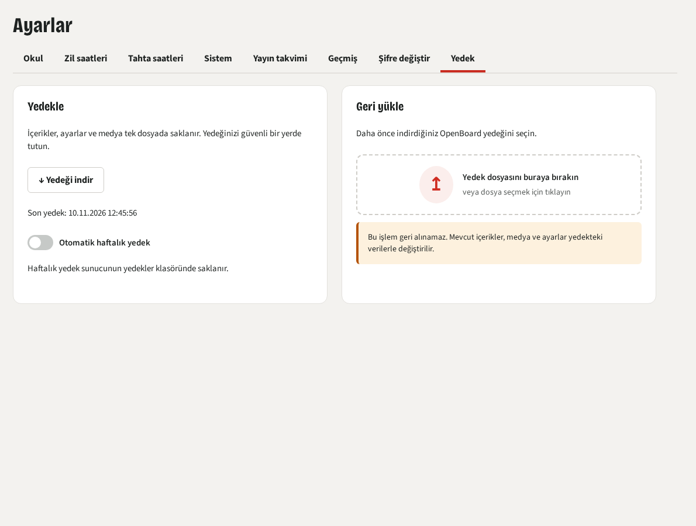

> Dikkat: Geri yükleme geri alınamaz. Mevcut içerikler, medya ve ayarlar yedekteki verilerle değişir. Yüklemeden önce güncel bir yedek al.

## 13. Geçmiş ve geri alma

Geçmiş, panoda yapılan her değişikliği tarih sırasıyla listeler ve yanlış yapılanı geri almanı sağlar.

1. **Ayarlar**'ı aç, **Geçmiş** sekmesine bas.
2. **Tümü**, **Duyuru**, **Medya**, **Turnuva** ya da **Düzen** etiketiyle listeyi süz.
3. Kayıtlar güne göre gruplanır. Her kayıtta ne olduğu ve saati yazar. İçerik değişikliklerinde **Önce** ve **Sonra** değerleri de görünür.
4. Geri dönmek istediğin kaydın yanındaki **Geri al**'a bas.
5. Liste uzunsa en altta **Daha fazla göster**'e bas.

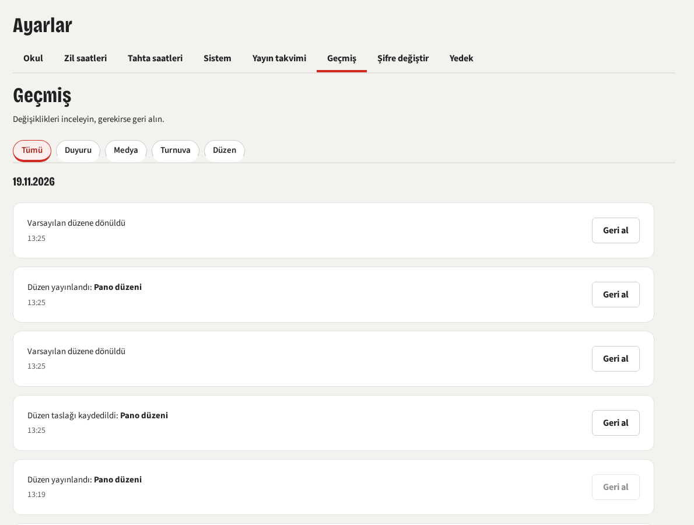

> İpucu: Düzeni bozduysan **Düzen** etiketini seç ve **Düzen yayınlandı** kaydından önceki duruma dön.

## 14. Telefonda kullanım

Yönetim ekranı telefon ekranına uyar. Duyuru eklemek, skor girmek ve acil duyuru vermek için tahtanın başına gitmen gerekmez.

1. Telefonundan yönetim adresini aç ve şifrenle gir (bkz. [Yönetime giriş](#1-yönetime-giriş)).
2. Alttaki çubukta **Ana sayfa**, **Ekle**, **İçerikler** ve **Daha fazla** düğmeleri durur. Üstte **Acil duyuru** her zaman görünür.
3. **Ekle**'ye bas, **Duyuru**'yu seç, başlığı yaz ve **Yayınla**'ya bas.
4. **Daha fazla** menüsü **Turnuvalar**, **Müzik**, **Düzen**, **Ayarlar**, **Hakkında** ve **Çıkış**'ı açar.

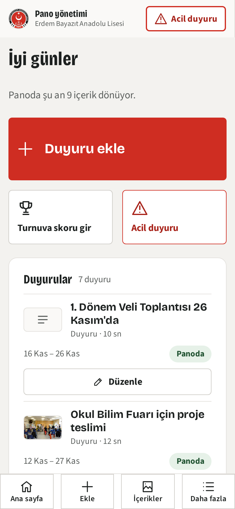

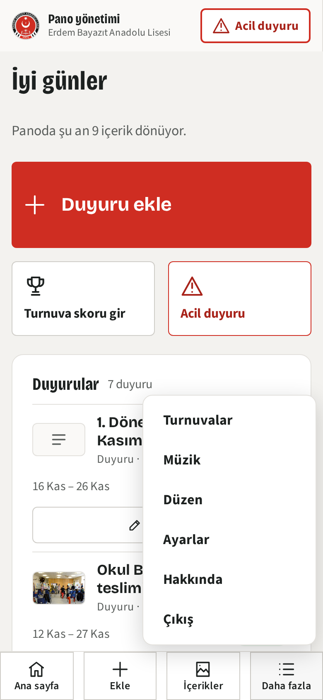

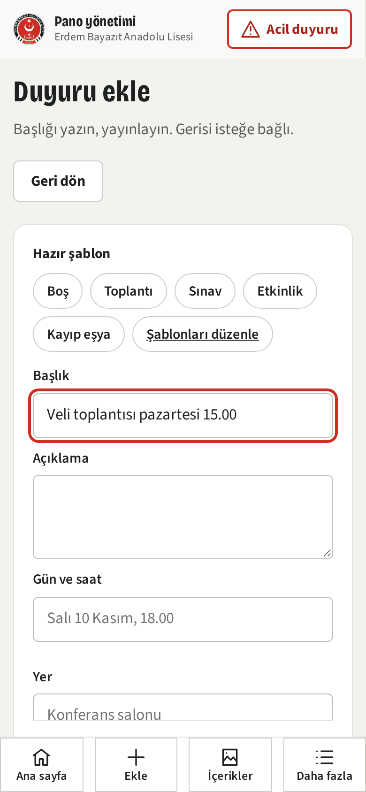

> İpucu: Düzen sayfasında kutuları sürükleyip boyutlandırmak masaüstünde daha rahattır. Telefonda duyuru, skor ve acil duyuru işlerini yap.
